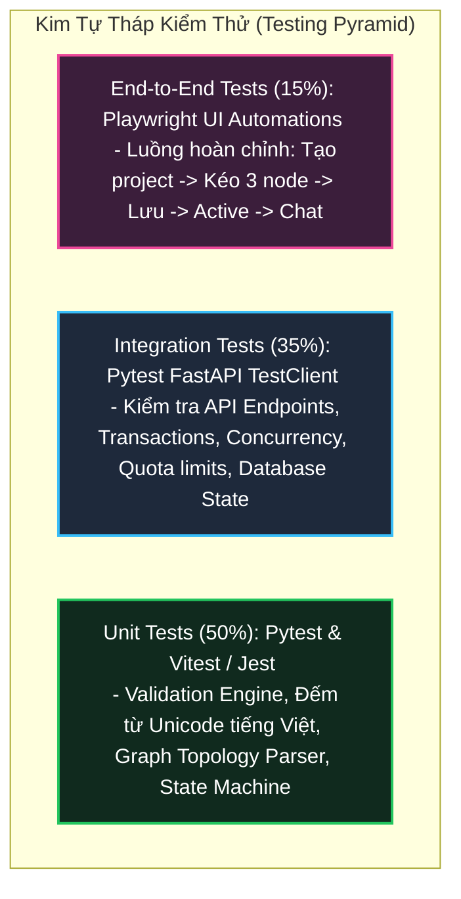

# 08. KẾ HOẠCH KIỂM THỬ VÀ BỘ TEST CASES CHI TIẾT (TEST PLAN & TEST CASES)
## Nhánh Tính Năng: Quản Lý Project (Project Management MVP)
### Hệ Thống: AI-Chan Virtual Assistant Platform

---

| Thông Tin Tài Liệu | Chi Tiết |
| :--- | :--- |
| **Mã Tài Liệu** | `DOC-PRJ-08` |
| **Trạng Thái** | `PROPOSED (Chờ Duyệt Từ Lead QA)` |
| **Vai Trò Phụ Trách** | Senior QA Engineer & Test Automation Architect |
| **Phiên Bản** | `1.0.0-MVP` |
| **Ngày Lập** | `2026-10-11` |

---

## 1. Chiến Lược Kiểm Thử (Testing Strategy & Test Pyramid)

### Các Cấp Độ Kiểm Thử Cụ Thể:
1. **Unit Testing (Kiểm thử đơn vị)**:
   - Thuật toán đếm từ tiếng Việt/Unicode: Kiểm tra các chuỗi ký tự đặc biệt, dấu câu, khoảng trắng liên tiếp, emoji.
   - Trình phân tích đồ thị (`GraphValidationEngine`): Kiểm tra các ma trận topology (đủ/thiếu node, chu trình, nối ngược).
2. **Integration Testing (Kiểm thử tích hợp)**:
   - Các API `/api/v1/projects/*`: Kiểm tra mã HTTP trả về, schema JSON response, ràng buộc khóa ngoại trong SQLite.
   - Kiểm thử tranh chấp đồng thời (Concurrency Testing): Dùng thư viện `asyncio` gửi 10 request kích hoạt cùng lúc khi chỉ còn 1 slot quota.
   - Kiểm thử chống IDOR: Tạo 2 tài khoản test (User 1 và User 2), dùng token User 2 để gọi API sửa/xóa project của User 1.
3. **End-to-End & UI Testing (Kiểm thử giao diện & đầu cuối)**:
   - Tương tác kéo thả trên Canvas: Kiểm tra việc thả node, nối handle, mở Config Drawer, lưu tọa độ và tải lại sau khi refresh trang.

---

## 2. Bảng Danh Mục Test Cases Chi Tiết (`PRJ-TC-xxx`)

### Nhóm 1: Ca Kiểm Thử Luồng Chính & Khởi Tạo (Happy Path & Initialization)

| Test Case ID | Tên Kịch Bản Kiểm Thử | Yêu Cầu Liên Quan | Tiền Điều Kiện (Preconditions) | Các Bước Thực Hiện (Steps) | Kết Quả Mong Đợi (Expected Results) | Mức Độ Ưu Tiên |
| :--- | :--- | :--- | :--- | :--- | :--- | :---: |
| **PRJ-TC-001** | Truy vấn danh sách project thành công | `PRJ-FR-001` | Người dùng đã đăng nhập, đã có sẵn 2 project trong DB. | 1. Gửi request `GET /api/v1/projects` với Bearer Token hợp lệ. | HTTP `200 OK`. Trả về mảng 2 phần tử chứa đúng `id`, `name`, `status`, `node_count`. Không chứa project của user khác. | **P0 (Critical)** |
| **PRJ-TC-002** | Tạo mới project với dữ liệu hợp lệ (Không cần xác thực) | `PRJ-FR-002`, `PRJ-BR-003` | Người dùng chưa đăng nhập hoặc đã đăng nhập (Không yêu cầu xác thực). | 1. Gửi request `POST /api/v1/projects` với `{ "name": "Trợ Lý AI", "description": "Mô tả test" }` (không cần Authorization header). | HTTP `201 Created`. Tạo bản ghi mới trong DB với `status = 'STOP'`, `is_valid = 0`. Trả về ID UUID v4. | **P0 (Critical)** |
| **PRJ-TC-003** | Tạo project thất bại khi tên rỗng hoặc quá dài | `PRJ-FR-002`, `PRJ-BR-002` | Người dùng đã đăng nhập. | 1. Gửi `POST /api/v1/projects` với `{ "name": "   " }` 2. Gửi với tên dài 150 ký tự. | HTTP `422 Unprocessable Entity` hoặc `400 Bad Request`. Bản ghi không được tạo trong DB. | **P1 (High)** |
| **PRJ-TC-004** | Tải chi tiết project và khôi phục graph | `PRJ-FR-003` | Project đã lưu sẵn graph 3 node và tọa độ. | 1. Gửi `GET /api/v1/projects/{id}`. | HTTP `200 OK`. Trả về đầy đủ `graph_data` gồm đúng 3 nodes, 2 edges và tọa độ viewport. | **P0 (Critical)** |

---

### Nhóm 2: Ca Kiểm Thử Quy Tắc Graph & Validation (Graph Validation Matrix)

| Test Case ID | Tên Kịch Bản Kiểm Thử | Yêu Cầu Liên Quan | Tiền Điều Kiện (Preconditions) | Các Bước Thực Hiện (Steps) | Kết Quả Mong Đợi (Expected Results) | Mức Độ Ưu Tiên |
| :--- | :--- | :--- | :--- | :--- | :--- | :---: |
| **PRJ-TC-005** | Lưu Graph hợp lệ 3 node tuyến tính | `PRJ-FR-005`, `PRJ-BR-004`, `PRJ-BR-005` | Project tồn tại ở `STOP`. | 1. Gửi `PUT /api/v1/projects/{id}/graph` chứa đúng 3 node (Input, Model, Output) và 2 edge theo thứ tự `Input -> Model -> Output`. | HTTP `200 OK`. `is_valid` được cập nhật thành `1`. Lưu bền vững trong DB. | **P0 (Critical)** |
| **PRJ-TC-006** | Từ chối Graph thiếu Node (chỉ có 2 node) | `PRJ-FR-014`, `PRJ-BR-004` | Project tồn tại. | 1. Gửi `PUT /api/v1/projects/{id}/graph` chỉ chứa Web Input và Model Node. | HTTP `422 Unprocessable Entity`. Báo lỗi `ERR_NODE_COUNT`: *"Graph phải chứa chính xác 3 Node"*. | **P0 (Critical)** |
| **PRJ-TC-007** | Từ chối Graph thừa Node trùng loại | `PRJ-FR-008`, `PRJ-BR-004` | Canvas đang mở. | 1. Cố gửi payload chứa 2 Model Node và 1 Input, 1 Output (Tổng 4 node). | HTTP `422 Unprocessable Entity`. Báo lỗi `ERR_NODE_COMPOSITION`. | **P0 (Critical)** |
| **PRJ-TC-008** | Từ chối Graph nối sai chiều (Ngược hoặc Vòng) | `PRJ-FR-013`, `PRJ-BR-005` | Project tồn tại. | 1. Gửi graph có cạnh từ Output sang Model (ngược chiều). | HTTP `422 Unprocessable Entity`. Báo lỗi `ERR_EDGE_MODEL_OUTPUT`. | **P0 (Critical)** |
| **PRJ-TC-009** | Từ chối Graph có cạnh nối tắt bỏ qua Model | `PRJ-FR-013`, `PRJ-BR-005` | Project tồn tại. | 1. Gửi graph có cạnh trực tiếp từ Web Input sang Output. | HTTP `422 Unprocessable Entity`. Báo lỗi chiều kết nối không hợp lệ. | **P0 (Critical)** |
| **PRJ-TC-010** | Từ chối lưu khi Model ID không tồn tại | `PRJ-FR-011`, `PRJ-BR-009` | Model Catalog không có model `gpt-99-unknown`. | 1. Cấu hình Model Node với `model_id = 'gpt-99-unknown'`. 2. Gửi request lưu graph. | HTTP `422 Unprocessable Entity`. Báo lỗi `ERR_MODEL_NOT_FOUND`. | **P1 (High)** |
| **PRJ-TC-011** | Từ chối lưu khi Provider chưa có API Key | `PRJ-FR-011`, `PRJ-BR-009` | Server chưa set biến môi trường `ANTHROPIC_API_KEY`. | 1. Cấu hình Model Node chọn `claude-3-7-sonnet`. 2. Gửi request lưu graph. | HTTP `422 Unprocessable Entity`. Báo lỗi `ERR_PROVIDER_KEY_MISSING`: *"Nhà cung cấp chưa có API Key"*. | **P1 (High)** |

---

### Nhóm 3: Ca Kiểm Thử Chuyển Đổi Trạng Thái & Hạn Ngạch Quota (State & Concurrency)

| Test Case ID | Tên Kịch Bản Kiểm Thử | Yêu Cầu Liên Quan | Tiền Điều Kiện (Preconditions) | Các Bước Thực Hiện (Steps) | Kết Quả Mong Đợi (Expected Results) | Mức Độ Ưu Tiên |
| :--- | :--- | :--- | :--- | :--- | :--- | :---: |
| **PRJ-TC-012** | Kích hoạt Project thành công khi còn Quota | `PRJ-FR-016`, `PRJ-BR-012` | User có 1 project active (`MAX = 3`). Graph project test hợp lệ 100%. | 1. Gửi `POST /api/v1/projects/{id}/activate`. | HTTP `200 OK`. `status` chuyển thành `ACTIVE`. Số lượng active tăng lên 2. | **P0 (Critical)** |
| **PRJ-TC-013** | Từ chối kích hoạt khi Graph chưa hợp lệ | `PRJ-FR-016`, `PRJ-BR-004` | Project có graph chưa đủ node (`is_valid == 0`). | 1. Gửi `POST /api/v1/projects/{id}/activate`. | HTTP `400 Bad Request`. Báo lỗi `GRAPH_NOT_VALID`. Trạng thái vẫn là `STOP`. | **P0 (Critical)** |
| **PRJ-TC-014** | Chặn kích hoạt khi đã đạt tối đa Quota (Cận biên) | `PRJ-FR-016`, `PRJ-BR-012` | User đã có 3 project đang `ACTIVE` (`MAX = 3`). | 1. Gửi `POST /api/v1/projects/{proj_4}/activate`. | HTTP `409 Conflict`. Báo lỗi `QUOTA_EXCEEDED`: *"Đã đạt tối đa 3 project active"*. Không có project nào vượt quá giới hạn. | **P0 (Critical)** |
| **PRJ-TC-015** | Kiểm thử Concurrency Race Condition khi kích hoạt | `PRJ-FR-019`, `PRJ-BR-013` | User có 2 project active (`MAX = 3`, còn đúng 1 slot). | 1. Gửi đồng thời 10 request kích hoạt cho Project A và Project B cùng 1 miligiây. | Đúng 1 request thành công (HTTP 200), các request còn lại trả về HTTP 409 Conflict. Tổng số project active sau test = 3. | **P0 (Critical)** |
| **PRJ-TC-016** | Tạm dừng và Vô hiệu hóa giải phóng Quota | `PRJ-FR-017`, `PRJ-FR-018` | Project đang ở trạng thái `ACTIVE`. | 1. Gửi `POST /api/v1/projects/{id}/stop`. 2. Kiểm tra quota của user. | HTTP `200 OK`. Trạng thái chuyển thành `STOP`. Số lượng active giảm đi 1, slot quota được hoàn trả. | **P1 (High)** |
| **PRJ-TC-017** | Xóa project active tự động hoàn trả Quota | `PRJ-FR-006`, `PRJ-BR-007` | Project đang ở trạng thái `ACTIVE`. | 1. Gửi `DELETE /api/v1/projects/{id}`. 2. Kiểm tra quota của user. | HTTP `200 OK`. Bản ghi chuyển thành `DELETED`. Quota active giảm đi 1 ngay lập tức. | **P1 (High)** |

---

### Nhóm 4: Ca Kiểm Thử Thực Thi Chat & Giới Hạn Từ (Execution & Word Limits)

| Test Case ID | Tên Kịch Bản Kiểm Thử | Yêu Cầu Liên Quan | Tiền Điều Kiện (Preconditions) | Các Bước Thực Hiện (Steps) | Kết Quả Mong Đợi (Expected Results) | Mức Độ Ưu Tiên |
| :--- | :--- | :--- | :--- | :--- | :--- | :---: |
| **PRJ-TC-018** | Chat thành công qua Project Active (Happy Path) | `PRJ-FR-022` | Project `active`, Web Input `max_words = 500`, Model `gemini-3.8-flash`. | 1. Gửi `POST /api/v1/projects/{id}/chat` với tin nhắn 10 từ tiếng Việt: *"Xin chào, hãy giải thích khái niệm Docker container giúp tôi"*. | HTTP `200 OK` (Stream SSE). Trả về các event `start`, `message`, `done` hoàn chỉnh. | **P0 (Critical)** |
| **PRJ-TC-019** | Chặn tin nhắn vượt quá giới hạn từ `max_words` | `PRJ-FR-022`, `PRJ-BR-008` | Project `active` có `max_words = 50`. | 1. Gửi tin nhắn chứa 80 từ tiếng Việt. | HTTP `400 Bad Request`. Báo lỗi `WORD_LIMIT_EXCEEDED`: `actual_words: 80, max_words: 50`. Không gọi sang LLM Provider. | **P0 (Critical)** |
| **PRJ-TC-020** | Kiểm tra độ chính xác đếm từ Tiếng Việt & Unicode | `PRJ-FR-010`, `PRJ-BR-008` | Project `active`. | 1. Gửi tin nhắn có nhiều khoảng trắng: `"Xin    chào     bạn   ! "` (4 từ). 2. Gửi chuỗi có dấu tiếng Việt, emoji, xuống dòng. | Hệ thống đếm chính xác số từ tách theo `\s+`, không tính khoảng trắng thừa làm từ. | **P1 (High)** |
| **PRJ-TC-021** | Từ chối Chat khi Project đang ở trạng thái `STOP` | `PRJ-FR-023`, `PRJ-BR-015` | Project ở trạng thái `STOP`. | 1. Gửi `POST /api/v1/projects/{id}/chat`. | HTTP `409 Conflict`. Báo lỗi `PROJECT_NOT_ACTIVE`: *"Project đang tạm dừng"*. | **P1 (High)** |
| **PRJ-TC-022** | Xử lý an toàn khi Model Provider gặp lỗi Timeout | `PRJ-FR-023` | Cổng LLM Provider giả lập timeout 30s. | 1. Gửi request chat qua project. | Backend bắt ngoại lệ timeout, trả về SSE event `error` thân thiện: *"Dịch vụ AI phản hồi chậm"*, không làm sập server. | **P1 (High)** |

---

### Nhóm 5: Ca Kiểm Thử An Ninh & Trải Nghiệm Giao Diện (Security & UX)

| Test Case ID | Tên Kịch Bản Kiểm Thử | Yêu Cầu Liên Quan | Tiền Điều Kiện (Preconditions) | Các Bước Thực Hiện (Steps) | Kết Quả Mong Đợi (Expected Results) | Mức Độ Ưu Tiên |
| :--- | :--- | :--- | :--- | :--- | :--- | :---: |
| **PRJ-TC-023** | Chống tấn công IDOR giữa 2 người dùng | `PRJ-NFR-005`, `PRJ-BR-001` | Project thuộc về User 1. Đăng nhập bằng token của User 2. | 1. User 2 gửi `GET /api/v1/projects/{user_1_proj_id}`. 2. User 2 gửi `PUT .../graph` để sửa project User 1. | Cả hai request đều trả về HTTP `404 Not Found` hoặc `403 Forbidden`. Dữ liệu của User 1 được bảo vệ 100%. | **P0 (Critical)** |
| **PRJ-TC-024** | Kiểm tra không để lộ API Key trong response | `PRJ-NFR-006` | Toàn bộ các API Project. | 1. Gọi tất cả API CRUD và Chat. 2. Quét toàn bộ JSON body và headers. | Tuyệt đối không chứa chuỗi API Key của Gemini/OpenAI/Anthropic/Groq. | **P0 (Critical)** |
| **PRJ-TC-025** | Hộp thoại cảnh báo Unsaved Changes trên UI | `PRJ-FR-015` | Người dùng đang sửa canvas, chưa bấm "Lưu". | 1. Nhấn nút "Quay lại" hoặc click vào logo để rời trang. | Trình duyệt hoặc modal hiện cảnh báo: *"Bạn có thay đổi chưa lưu, vẫn muốn rời đi?"*. Ngăn chặn mất dữ liệu ngoài ý muốn. | **P1 (High)** |
