# PHẦN 09: BỘ BIỂU ĐỒ MERMAID CHUẨN HÓA (SYSTEM MERMAID DIAGRAMS)
## Phân Hệ: Quản Lý Quy Tắc (Rules Management — Rules Library & Rule Editor)
### Dự Án: Nền Tảng Trợ Lý Ảo AI-Chan (AI-Chan Assistant Platform)

---

| Thông Tin Quản Trị | Chi Tiết |
| :--- | :--- |
| **Mã Tài Liệu** | `RUL-DOC-09` |
| **Nhánh Tính Năng** | **Rules Management (Rules Library & Rule Editor)** |
| **Trạng Thái Quản Trị** | **`PROPOSED (Chờ Duyệt Từ Architecture Board & Product Owner)`** |
| **Phiên Bản** | `1.0.0-PROPOSAL` |
| **Ngày Ban Hành** | `2026-10-18` |
| **Tác Giả / Vai Trò** | Senior Solution Architect & Technical Writer |

---

## Danh Mục 16 Biểu Đồ Kỹ Thuật Bắt Buộc

Tài liệu này tập hợp đầy đủ **16 biểu đồ Mermaid chuẩn hóa** mô tả trực quan và chính xác toàn bộ kiến trúc, luồng người dùng, chu trình gọi API, máy trạng thái, mô hình dữ liệu quan hệ, quy trình an ninh và cơ chế giải quyết quy tắc của phân hệ Rules Management:

1. **`RUL-DIA-01`**: Use Case Diagram — Quản Lý Thư Viện Rules (Rules Library)
2. **`RUL-DIA-02`**: Use Case Diagram — Quản Lý Chi Tiết & Soạn Thảo Rule (Rule Detail & Editor)
3. **`RUL-DIA-03`**: User Flow — Mở Thư Viện Rules, Tìm Kiếm, Lọc & Mở Rule
4. **`RUL-DIA-04`**: User Flow — Tạo Mới, Soạn Thảo, Lưu & Xử Lý Biểu Mẫu Chưa Lưu (Dirty State)
5. **`RUL-DIA-05`**: Swimlane Diagram — Phân Vai Trò End-to-End (User → Frontend → API → Service → Database)
6. **`RUL-DIA-06`**: Sequence Diagram — Tải Danh Sách Rules (Pagination, Search, Scope Filters)
7. **`RUL-DIA-07`**: Sequence Diagram — Tạo Mới Rule (Client Validation, Duplicate Check, Persistence)
8. **`RUL-DIA-08`**: Sequence Diagram — Cập Nhật Rule & Xử Lý Xung Đột Ghi Đè (Optimistic Concurrency)
9. **`RUL-DIA-09`**: Sequence Diagram — Xóa Mềm Rule & Kiểm Tra Dự Án Đang Sử Dụng (Delete In-Use Guard)
10. **`RUL-DIA-10`**: State Diagram — Vòng Đời Dữ Liệu Rule & Trạng Thái Biểu Mẫu UI
11. **`RUL-DIA-11`**: Entity-Relationship Diagram (ERD) — Bảng Rules & Quan Hệ Với Users, Projects
12. **`RUL-DIA-12`**: Component & Architecture Diagram — Kiến Trúc Hệ Thống & Điểm Tích Hợp Runtime
13. **`RUL-DIA-13`**: Security Flow — Kiểm Soát Quyền Truy Cập Anti-IDOR & Bảo Vệ System Rules
14. **`RUL-DIA-14`**: Rule Activation & Resolution Flow — Cơ Chế Phân Giải Quy Tắc Lúc Chạy (Proposed Runtime)
15. **`RUL-DIA-15`**: Error Handling & Recovery Flow — Xử Lý Ngoại Lệ (400, 401, 403, 404, 409, 422, 500)
16. **`RUL-DIA-16`**: Traceability & Feature Dependency Diagram — Ma Trận Phụ Thuộc Tính Năng

---

## 1. Biểu Đồ 01: Use Case Diagram — Thư Viện Rules (`RUL-DIA-01`)

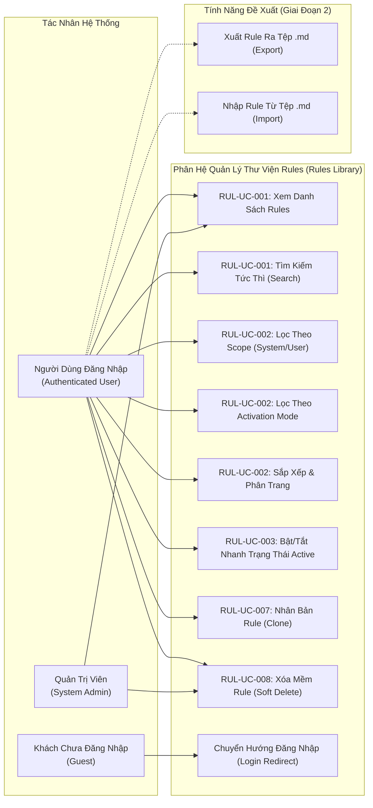

---

## 2. Biểu Đồ 02: Use Case Diagram — Quản Lý Từng Rule & Soạn Thảo (`RUL-DIA-02`)

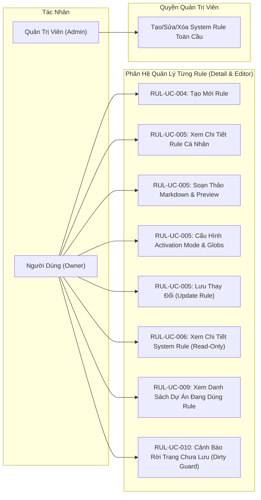

---

## 3. Biểu Đồ 03: User Flow — Mở Thư Viện, Tìm Kiếm, Lọc & Xem Rule (`RUL-DIA-03`)

```mermaid
flowchart TD
    Start([Bắt đầu: Người dùng mở menu "Rules"]) --> CheckAuth{Đã đăng nhập?}
    
    CheckAuth -- Chưa --> RedirectLogin[Chuyển hướng về trang /login] --> EndFail([Kết thúc])
    
    CheckAuth -- Đã đăng nhập --> LoadAPI[Frontend gọi GET /api/v1/rules]
    
    LoadAPI --> CheckStatus{Kết quả API?}
    CheckStatus -- Lỗi 500/Mạng --> ShowError[Hiển thị Error State: Nút Thử Lại] --> EndError([Dừng])
    CheckStatus -- 200 OK & Trống --> ShowEmpty[Hiển thị Empty State: Nút Tạo Mới]
    
    CheckStatus -- 200 OK & Có Data --> ShowList[Hiển thị danh sách Rules Cards / Table]
    
    ShowList --> UserAction{Người dùng thao tác?}
    
    UserAction -- "Nhập từ khóa tìm kiếm" --> DebounceSearch[Debounce 300ms: Lọc tên/mô tả/tags]
    DebounceSearch --> CheckResults{Có kết quả?}
    CheckResults -- Không --> ShowNoResult[Hiển thị No-Results State: Nút Xóa Lọc] --> ShowList
    CheckResults -- Có --> ShowList
    
    UserAction -- "Chọn Filter (Scope / Trigger / Status)" --> ApplyFilter[Áp dụng bộ lọc client/server] --> ShowList
    
    UserAction -- "Click một Rule để xem" --> CheckScope{Loại Rule?}
    CheckScope -- "User Rule (Cá nhân)" --> OpenEditable["Mở /rules/:id (Chế độ Soạn Thảo / Chỉnh Sửa)"] --> EndSuccess([Hoàn tất])
    CheckScope -- "System Rule (Hệ thống)" --> OpenReadOnly["Mở /rules/:id (Chế độ Chỉ Đọc & Banner thông báo)"] --> EndSuccess
```

---

## 4. Biểu Đồ 04: User Flow — Tạo / Sửa / Lưu / Hủy Rule & Dirty State (`RUL-DIA-04`)

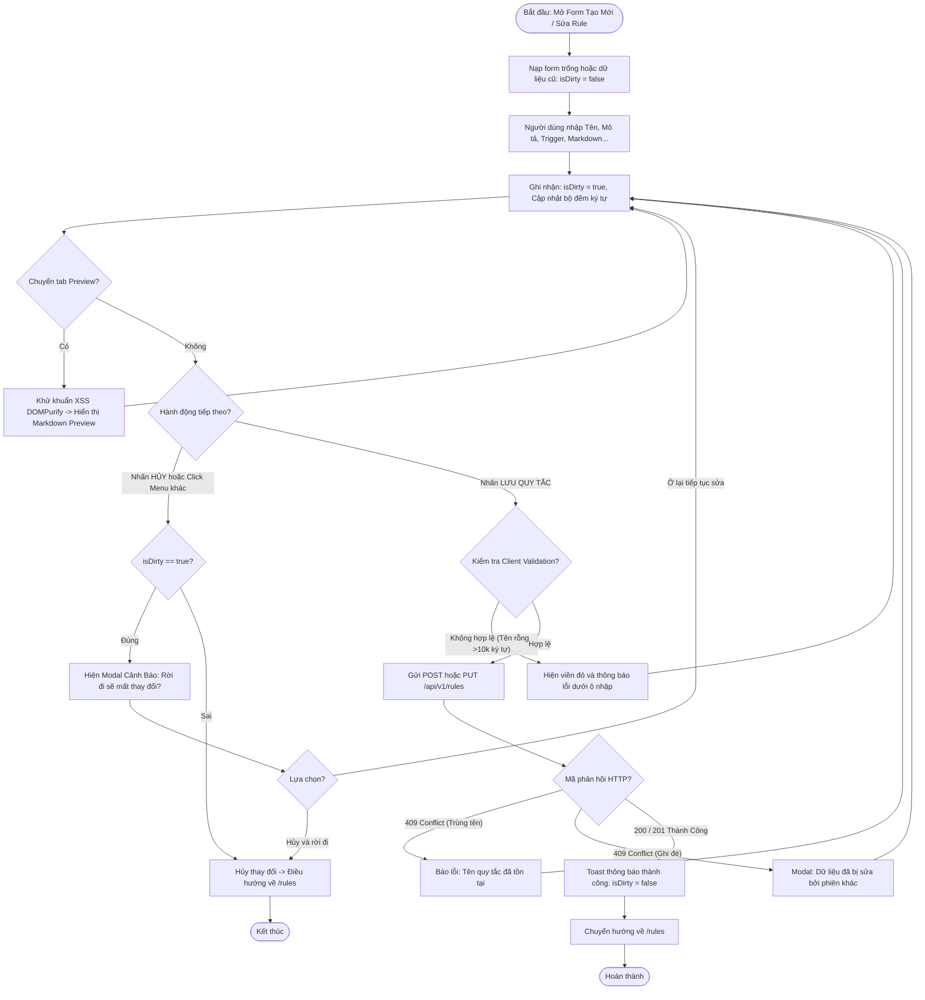

---

## 5. Biểu Đồ 05: Swimlane Diagram — Phân Vai Trò End-to-End (`RUL-DIA-05`)

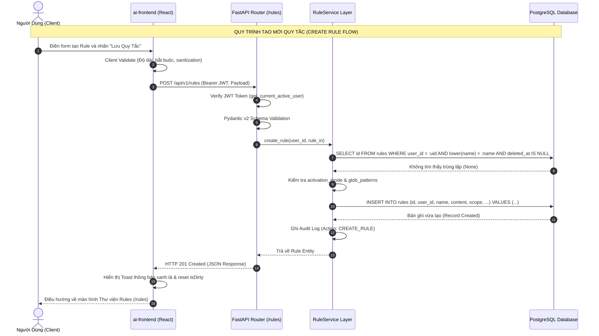

---

## 6. Biểu Đồ 06: Sequence Diagram — Tải Danh Sách Rules (`RUL-DIA-06`)

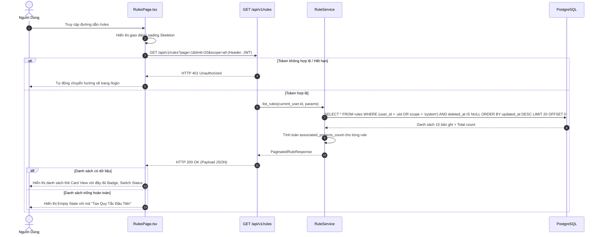

---

## 7. Biểu Đồ 07: Sequence Diagram — Tạo Mới Rule (`RUL-DIA-07`)

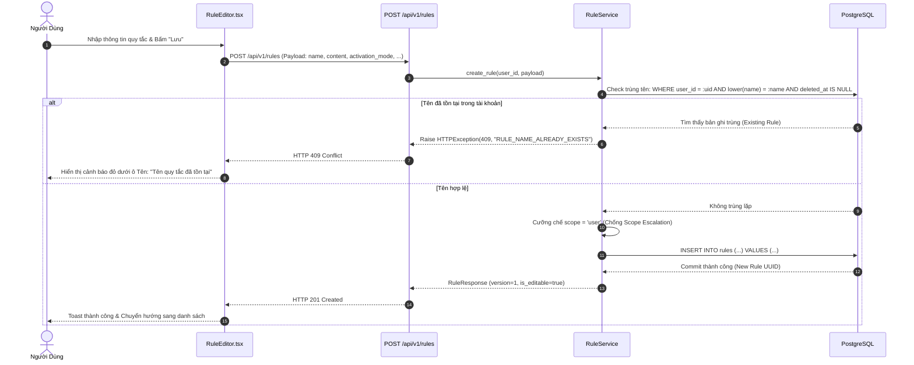

---

## 8. Biểu Đồ 08: Sequence Diagram — Cập Nhật Rule & Xử Lý Xung Đột (`RUL-DIA-08`)

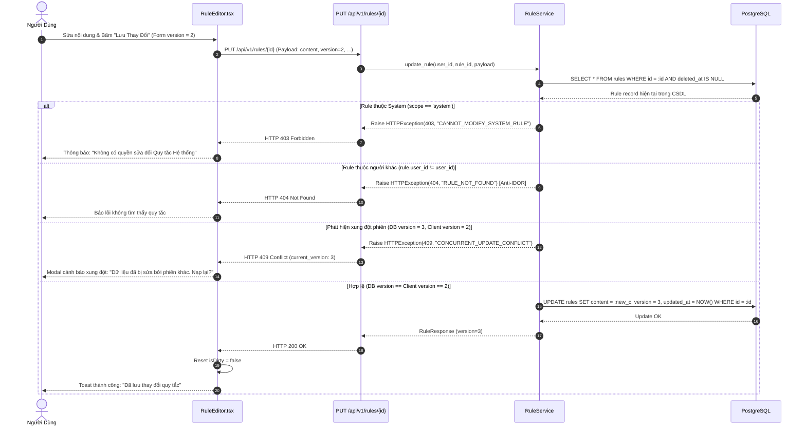

---

## 9. Biểu Đồ 09: Sequence Diagram — Xóa Mềm Rule & Kiểm Tra Dự Án Sử Dụng (`RUL-DIA-09`)

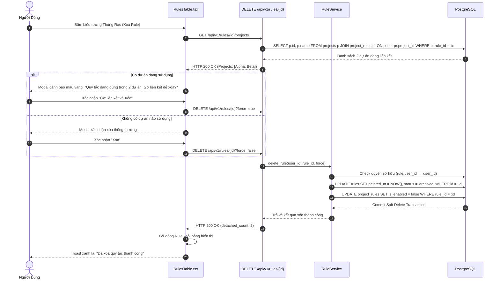

---

## 10. Biểu Đồ 10: State Diagram — Vòng Đời Dữ Liệu Rule & Trạng Thái Biểu Mẫu UI (`RUL-DIA-10`)

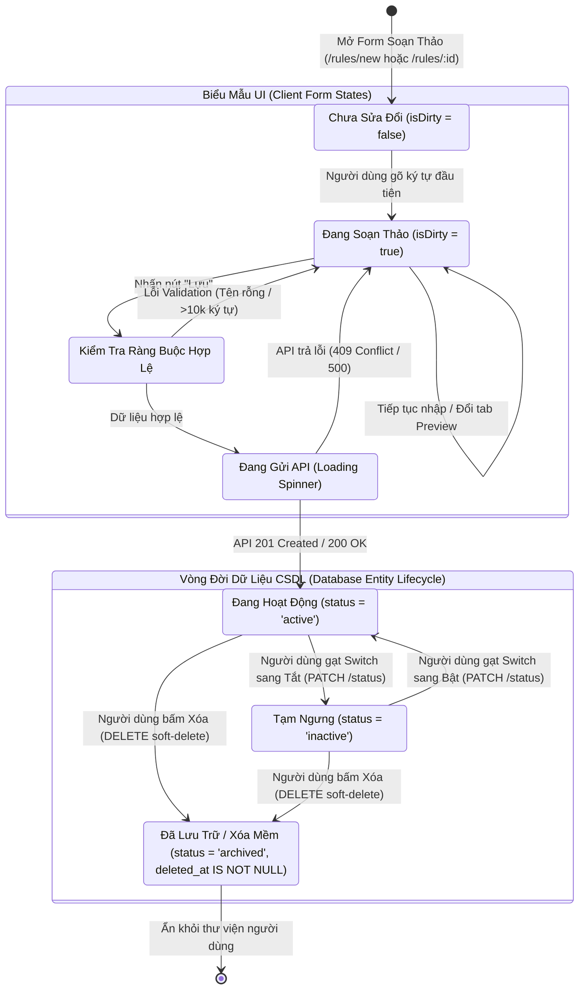

---

## 11. Biểu Đồ 11: Entity-Relationship Diagram (ERD) (`RUL-DIA-11`)

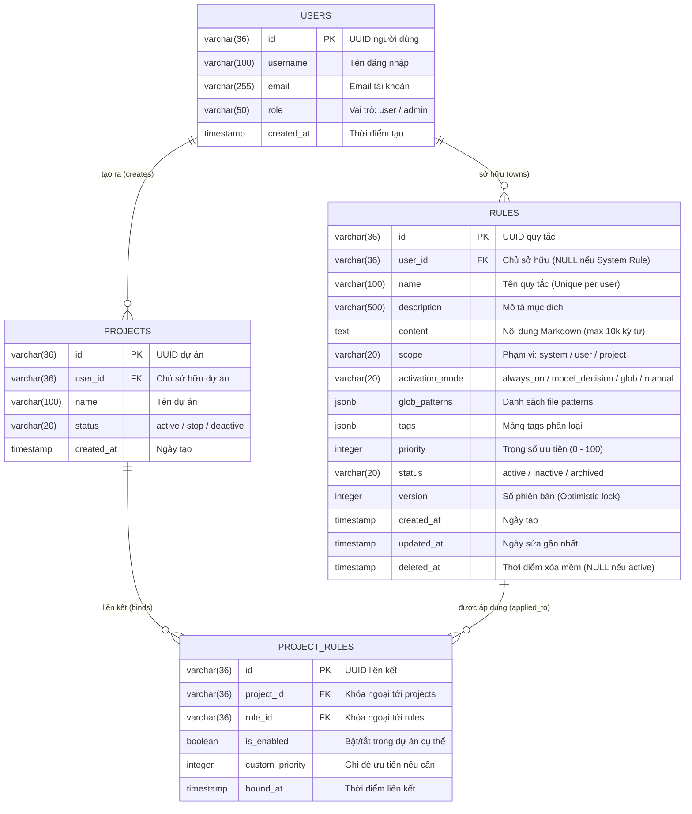

---

## 12. Biểu Đồ 12: Component & Architecture Diagram (`RUL-DIA-12`)

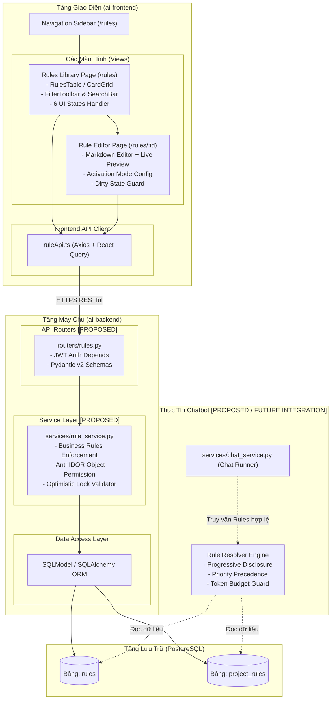

---

## 13. Biểu Đồ 13: Security Flow — Kiểm Soát Quyền Truy Cập & Anti-IDOR (`RUL-DIA-13`)

```mermaid
flowchart TD
    Start([Yêu cầu từ Client gửi tới API Rule]) --> CheckToken{Bearer JWT hợp lệ?}
    
    CheckToken -- Không hợp lệ / Hết hạn --> Return401[Trả về HTTP 401 Unauthorized] --> EndFail([Chặn])
    
    CheckToken -- Hợp lệ --> ExtractUser[Giải mã payload JWT: Lấy current_user.id và role]
    
    ExtractUser --> CheckAction{Thao tác yêu cầu?}
    
    CheckAction -- "Tạo mới (POST)" --> CheckScopeInput{Body scope == 'system'?}
    CheckScopeInput -- Đúng --> CheckAdminRole{role == 'admin'?}
    CheckAdminRole -- Sai --> ForceUserScope["Tự động ép scope = 'user' (Chống Scope Escalation)"] --> ProceedWrite[Tiến hành ghi dữ liệu]
    CheckAdminRole -- Đúng --> ProceedWrite
    CheckScopeInput -- Sai --> ProceedWrite
    
    CheckAction -- "Đọc / Sửa / Xóa (GET, PUT, DELETE)" --> QueryDB[Truy vấn Rule trong CSDL theo ID]
    QueryDB --> CheckExist{Bản ghi tồn tại & deleted_at IS NULL?}
    CheckExist -- Không --> Return404[Trả về HTTP 404 Not Found] --> EndFail
    
    CheckExist -- Có --> CheckRuleScope{Rule scope?}
    
    CheckRuleScope -- "system" --> CheckWriteOp{Yêu cầu ghi (PUT/DELETE)?}
    CheckWriteOp -- Đúng --> CheckAdminWrite{role == 'admin'?}
    CheckAdminWrite -- Sai --> Return403[Trả về HTTP 403 Forbidden: Cấm sửa System Rule] --> EndFail
    CheckAdminWrite -- Đúng --> ProceedWrite
    CheckWriteOp -- Sai (Chỉ đọc GET) --> Return200[Cho phép đọc dữ liệu] --> EndOK([Hoàn thành])
    
    CheckRuleScope -- "user" --> CheckOwner{rule.user_id == current_user.id?}
    CheckOwner -- Sai (IDOR Attack) --> Return404AntiIDOR["Trả về HTTP 404 Not Found (Ẩn thông tin UUID)"] --> EndFail
    CheckOwner -- Đúng --> ProceedWrite --> Return200
```

---

## 14. Biểu Đồ 14: Rule Activation & Resolution Flow (Proposed Runtime) (`RUL-DIA-14`)

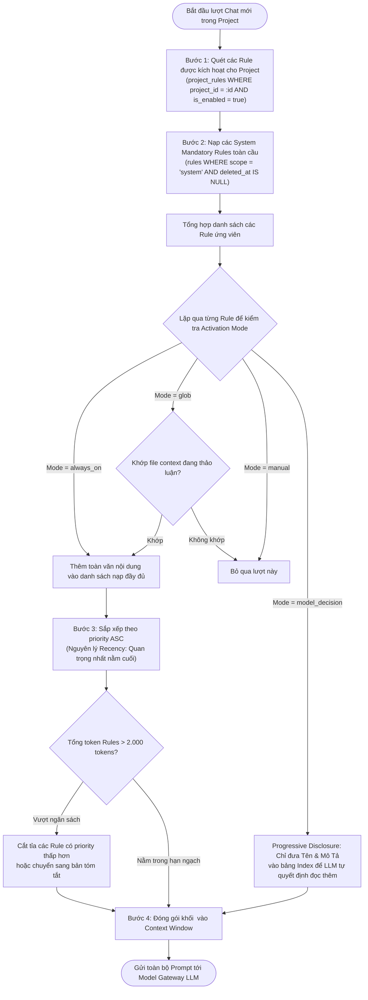

---

## 15. Biểu Đồ 15: Error Handling & Recovery Flow (`RUL-DIA-15`)

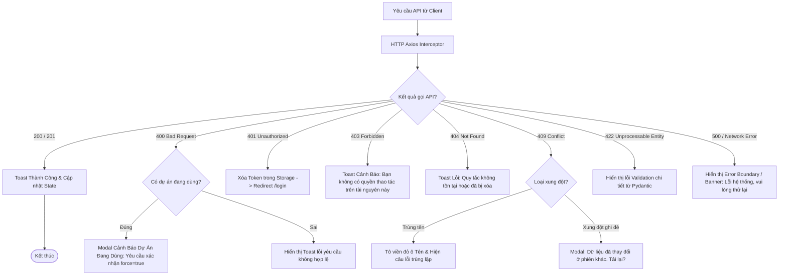

---

## 16. Biểu Đồ 16: Traceability & Feature Dependency Diagram (`RUL-DIA-16`)

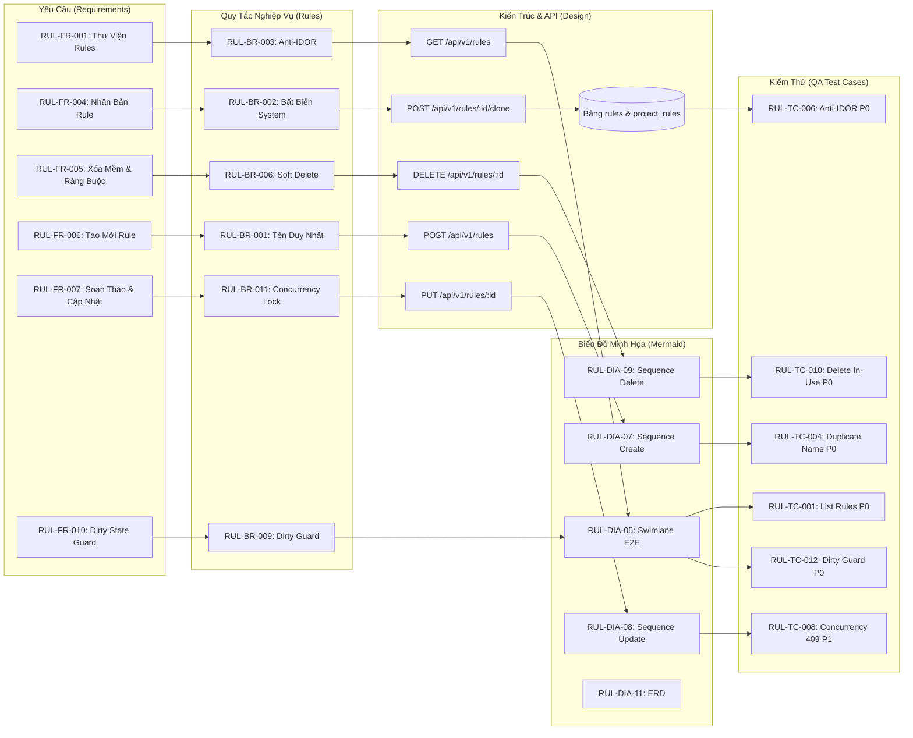
