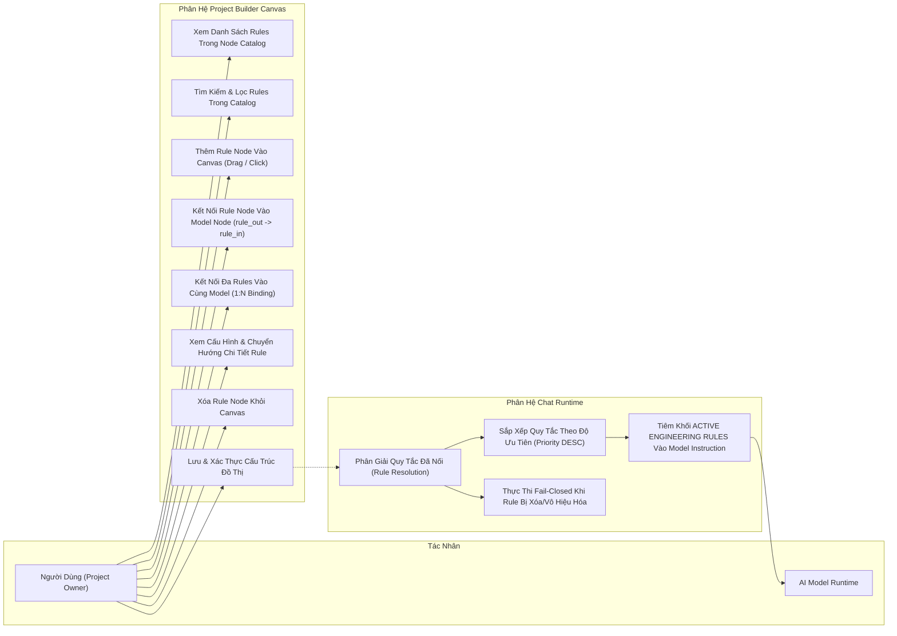
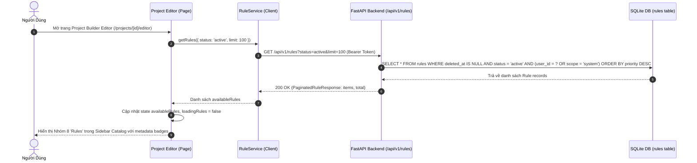
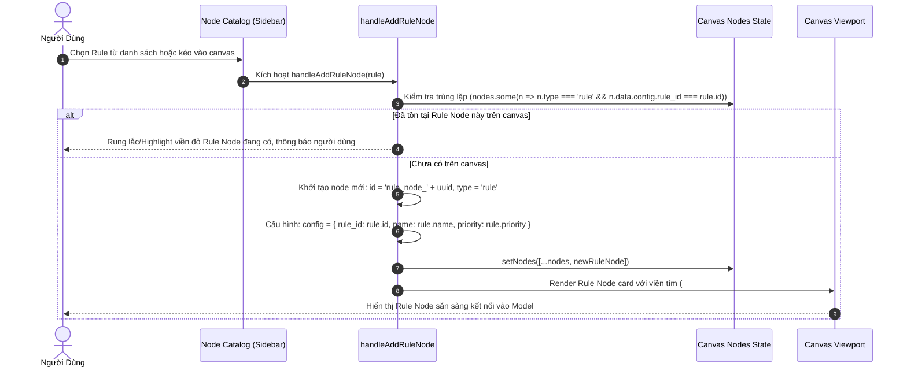
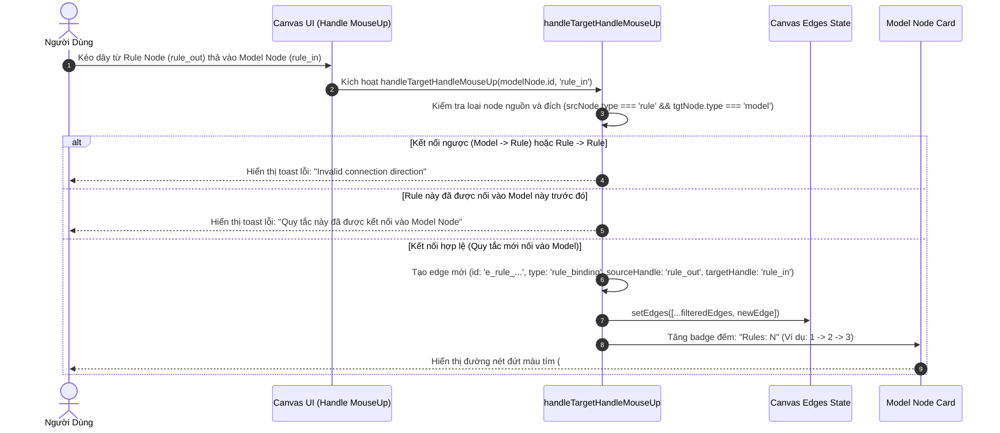
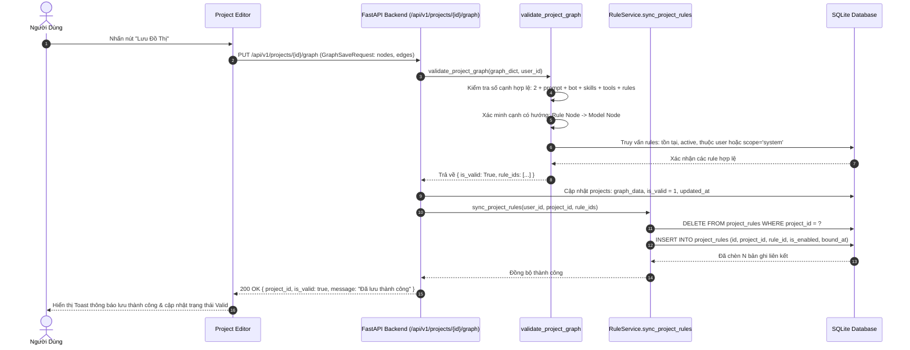
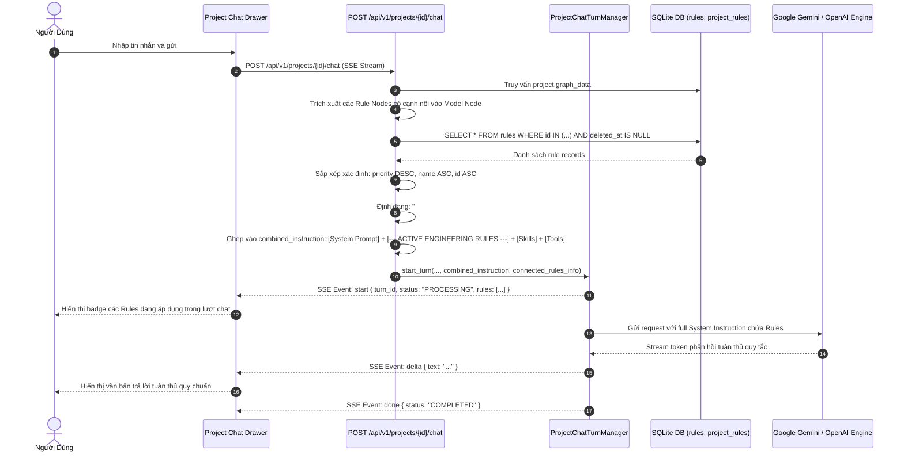
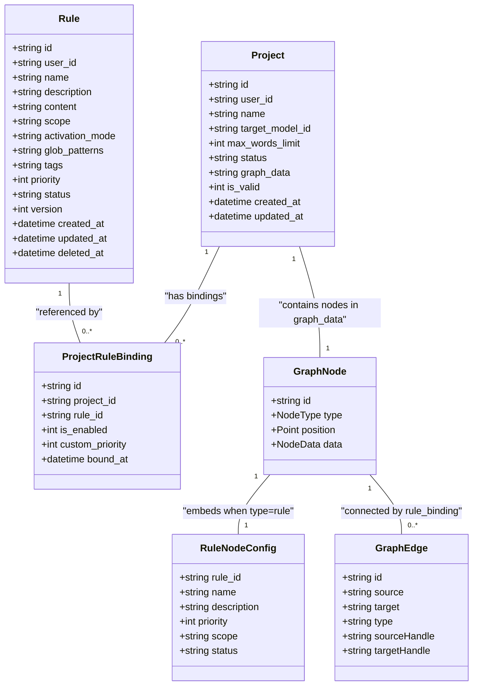
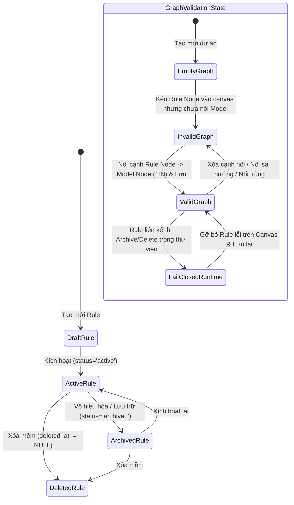
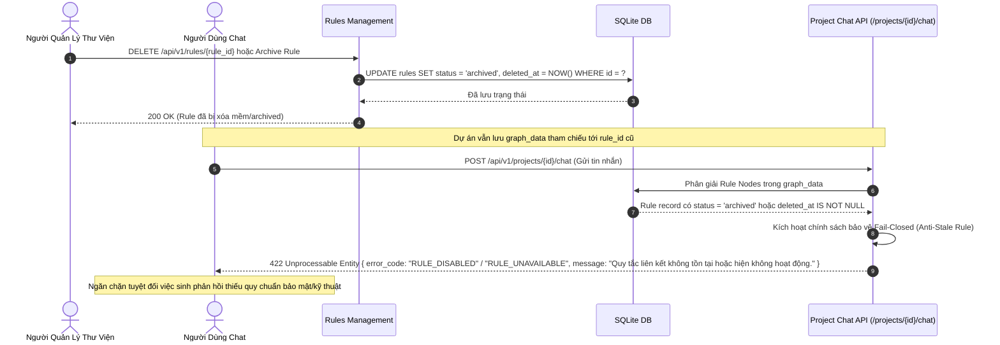

# TÀI LIỆU KỸ THUẬT: TÍCH HỢP RULES LIBRARY VÀO PROJECT NODE CATALOG & QUAN HỆ MODEL ↔ NHIỀU RULES (1:N)

| Thông Tin Quản Trị | Chi Tiết |
| :--- | :--- |
| **Mã Tài Liệu** | `RUL-DOC-13` / `PRJ-DOC-11` |
| **Phân Hệ** | **Rules Management & Project Builder (Node Catalog, Canvas Graph, Chat Runtime)** |
| **Trạng Thái** | **`APPROVED & IMPLEMENTED`** |
| **Phiên Bản** | `1.0.0` |
| **Ngày Hoàn Thành** | `2026-10-18` |
| **Tác Giả** | Senior Full-Stack Engineer, Solution Architect & QA Engineer |
| **Truy Vết Yêu Cầu** | `RUL-FR-001`, `RUL-FR-003`, `RUL-FR-011`, `PRJ-FR-006`, `PRJ-BR-008`, `PRJ-BR-009`, `PRJ-BR-010` |

---

## 1. TỔNG QUAN & MỤC TIÊU NGHIỆP VỤ

### 1.1 Mục Tiêu Hệ Thống
Tính năng tích hợp **Rules Library** vào **Project Builder / Node Catalog** cho phép người dùng AI-Chan cấu hình các quy chuẩn kỹ thuật (Coding standards, Security guardrails, Brand persona, Domain policies) trực tiếp trên giao diện Canvas trực quan:
- **Node Catalog Rules Group**: Nhóm Catalog thứ 8 hiển thị các active rules được truy vấn từ backend API thực tế (`GET /api/v1/rules?status=active&limit=100`).
- **Thao tác Kéo/Thả/Click-to-Add**: Tạo Rule Node trên canvas với nhãn hiển thị, cấu hình `rule_id`, các badge phạm vi (`system`/`user`), độ ưu tiên (`priority`), và nút xóa.
- **Quan hệ 1:N (1 Model Node ↔ Nhiều Rule Nodes)**: Một Model Node có thể tiếp nhận nhiều chỉ dẫn quy tắc cùng lúc.
- **Quy ước Hướng Kết Nối (Edge Convention)**: Hướng cạnh chuẩn mực là `Rule Node → Model Node` (Edge type: `'rule_binding'`, Source Handle: `'rule_out'`, Target Handle: `'rule_in'`). Điều này phản ánh chính xác dòng chảy chỉ dẫn nhận thức nạp vào mô hình (tương tự System Prompt), tránh xung đột với các cổng xuất công cụ/kỹ năng (`Model -> Tool`, `Model -> Skill`, `Model -> Bot`, `Model -> Output`).
- **Kiểm Soát Tính Hợp Lệ Lưỡng Cực (Frontend + Backend Dual Validation)**:
  - Chặn kết nối ngược (`Model -> Rule`).
  - Chặn kết nối giữa 2 Rule (`Rule -> Rule`).
  - Chặn kết nối Rule tới các node khác (`Rule -> Input/Output/Tool/Bot`).
  - Chặn liên kết trùng lặp cùng một `rule_id` vào một Model Node.
  - Ngăn chặn IDOR: người dùng không thể gắn Rule riêng tư của người dùng khác vào Project của mình (ngoại trừ System Rules).
- **Đồng Bộ Bền Vững (Graph Persistence & Sync)**: Khi người dùng lưu Canvas Graph (`PUT /api/v1/projects/{id}/graph`), hệ thống tự động đồng bộ hóa danh sách `rule_ids` hợp lệ vào bảng cơ sở dữ liệu `project_rules` thông qua `RuleService.sync_project_rules`.
- **Phân Giải Thời Gian Thực Khi Chat (Runtime Chat Resolution & Deterministic Order)**: Khi streaming hội thoại (`POST /api/v1/projects/{id}/chat`), backend phân giải động các Rule Nodes được nối vào Model từ CSDL, sắp xếp xác định theo `priority DESC, name ASC, id ASC`, và tiêm vào `combined_instruction` dưới khối định dạng `--- ACTIVE ENGINEERING RULES ---`. Nếu rule bị vô hiệu hóa hoặc xóa sau khi lưu graph, hệ thống lập tức từ chối lượt chat với lỗi 422 (Fail-closed).

---

## 2. BỘ 10 SƠ ĐỒ MERMAID CHUẨN HÓA

### 2.1 Sơ Đồ 01: Use Case Diagram — Quản Lý & Liên Kết Rules Vào Model/Project (`RUL-PRJ-DIA-01`)



---

### 2.2 Sơ Đồ 02: Sequence Diagram — Tải Node Catalog & Lấy Danh Sách Rules (`RUL-PRJ-DIA-02`)



---

### 2.3 Sơ Đồ 03: Sequence Diagram — Kéo Thả / Click Rule Vào Canvas & Khởi Tạo Rule Node (`RUL-PRJ-DIA-03`)



---

### 2.4 Sơ Đồ 04: Sequence Diagram — Kết Nối 1 Model Node Với Nhiều Rule Nodes (1:N) & Kiểm Tra Hợp Lệ (`RUL-PRJ-DIA-04`)



---

### 2.5 Sơ Đồ 05: Sequence Diagram — Lưu Graph, Kiểm Tra Backend & Đồng Bộ CSDL (`RUL-PRJ-DIA-05`)



---

### 2.6 Sơ Đồ 06: Sequence Diagram — Runtime Chat Phân Giải & Nạp Rules Đã Liên Kết (`RUL-PRJ-DIA-06`)



---

### 2.7 Sơ Đồ 07: Class/Entity/Graph Model Diagram — Cấu Trúc Dữ Liệu & Quan Hệ CSDL (`RUL-PRJ-DIA-07`)



---

### 2.8 Sơ Đồ 08: State Diagram — Vòng Đời Trạng Thái Rule & Tính Hợp Lệ Của Graph (`RUL-PRJ-DIA-08`)



---

### 2.9 Sơ Đồ 09: Sequence Diagram — Xử Lý Khi Rule Bị Vô Hiệu Hóa/Xóa Khỏi Thư Viện (Fail-Closed) (`RUL-PRJ-DIA-09`)



---

### 2.10 Sơ Đồ 10: Component & Architecture Diagram — Kiến Trúc Tổng Thể Tính Năng (`RUL-PRJ-DIA-10`)

```mermaid
flowchart TB
    subgraph Frontend["Frontend Layer (Next.js 14 App Router)"]
        Catalog["Node Catalog Component<br>(Group 8: Rules Library)"]
        CanvasEditor["Project Builder Canvas Editor<br>(React Flow Custom Layout)"]
        RuleNodeUI["Rule Node View Card<br>(Handle: rule_out, Purple Border)"]
        ModelNodeUI["Model Node View Card<br>(Handle: rule_in, Rules Counter Badge)"]
        Drawer["Config Drawer & Rule Deep Link"]
        ChatUI["Project Chat Drawer<br>(Active Rules Badges & SSE Client)"]
    end

    subgraph BackendAPI["Backend API Layer (FastAPI)"]
        RulesRouter["/api/v1/rules Router<br>(Rule CRUD, Clone, Scope Filters)"]
        ProjectsRouter["/api/v1/projects Router<br>(Graph Validation, Save, Chat Stream)"]
        GraphValidator["Graph Structure Validator<br>(Edge & Direction Rules, Anti-IDOR)"]
    end

    subgraph ServiceLayer["Service & Business Logic"]
        RuleService["RuleService<br>(sync_project_rules, resolve_rules)"]
        TurnManager["ProjectChatTurnManager<br>(Deterministic Rule Sort & Injection)"]
    end

    subgraph DataStorage["Persistence Layer (SQLite Database)"]
        TableRules[("rules<br>(id, scope, priority, content, status)")]
        TableProjectRules[("project_rules<br>(project_id, rule_id, is_enabled)")]
        TableProjects[("projects<br>(graph_data, target_model_id, is_valid)")]
    end

    subgraph ExternalEngine["AI Inference Service"]
        LLMProvider["Google Gemini / OpenAI Engine<br>(System Instructions with Rules)"]
    end

    Catalog -->|GET /api/v1/rules| RulesRouter
    CanvasEditor -->|Drag/Click| RuleNodeUI
    RuleNodeUI -->|rule_out -> rule_in| ModelNodeUI
    CanvasEditor --> Drawer
    CanvasEditor -->|PUT /projects/{id}/graph| ProjectsRouter
    
    ProjectsRouter --> GraphValidator
    ProjectsRouter --> RuleService
    RuleService --> TableProjectRules
    GraphValidator --> TableRules
    ProjectsRouter --> TableProjects

    ChatUI -->|POST /projects/{id}/chat| ProjectsRouter
    ProjectsRouter --> TurnManager
    TurnManager --> RuleService
    RuleService --> TableRules
    TurnManager --> LLMProvider
```

---

## 3. THIẾT KẾ CHI TIẾT & QUY TẮC LIÊN KẾT

### 3.1 Quy Ước Cổng Kết Nối & Đồ Thị
- **Cổng Nguồn**: `rule_out` trên `Rule Node` (vị trí bên phải node, màu tím `#a855f7`).
- **Cổng Đích**: `rule_in` trên `Model Node` (vị trí bên trái node, `top: 52%`, màu tím `#a855f7`, nằm giữa `input_handle` và `prompt_in`).
- **Loại Cạnh (Edge Type)**: `'rule_binding'`.
- **Màu Sắc & Kiểu Dáng Cạnh**: Màu tím tím sáng (`#a855f7`), nét đứt SVG `strokeDasharray: "5 3"`.
- **Bội Số Quan Hệ (Multiplicity)**:
  - `Model Node ↔ Rule Nodes`: **1 : N** (Một Model có thể nhận 0, 1 hoặc nhiều Rule Nodes).
  - `Rule Node ↔ Model Node`: **1 : 1** (Một Rule Node cụ thể trên canvas chỉ liên kết vào duy nhất một Model Node).
  - `Cấm Duplicate Rule ID`: Hai Rule Nodes khác nhau trên canvas không được cùng mang một `rule_id` khi nối vào cùng một Model Node.

### 3.2 Quy Trình Sắp Xếp Xác Định (Deterministic Ordering)
Nhằm đảm bảo prompt caching của LLM hoạt động tối ưu và không gây phân tán ngữ nghĩa, các quy tắc được sắp xếp theo thứ tự nghiêm ngặt:
$$\text{Priority (Giảm dần)} \longrightarrow \text{Name (A-Z)} \longrightarrow \text{Rule ID (A-Z)}$$

### 3.3 Định Dạng Tiêm Khối Quy Tắc (Injection Format)
Khối quy tắc được chèn vào `combined_instruction` ngay sau `System Prompt` và trước `Skills`/`Tools`:
```markdown
[System Prompt Content]

--- ACTIVE ENGINEERING RULES ---
### Rule: [Rule Name 1]
[Rule Content 1]

### Rule: [Rule Name 2]
[Rule Content 2]
--- END ACTIVE ENGINEERING RULES ---

--- ACTIVE SKILLS INSTRUCTIONS ---
...
--- END SKILLS INSTRUCTIONS ---

--- AVAILABLE TOOLS FOR THIS MODEL ---
...
--- END AVAILABLE TOOLS ---
```

---

## 4. MA TRẬN TRUY VẾT & BẰNG CHỨNG KIỂM THỬ

| Mã Kiểm Thử | Tầng | Mục Tiêu Kiểm Thử | Kết Quả |
| :--- | :--- | :--- | :--- |
| `TC-CANVAS-016` | Frontend | Kết nối hợp lệ Rule Node -> Model Node vào cổng `rule_in` | **PASS (100%)** |
| `TC-CANVAS-017` | Frontend | Kết nối 1 Model Node với 3 Rule Nodes riêng biệt (1:N) | **PASS (100%)** |
| `TC-CANVAS-018` | Frontend | Từ chối kết nối trùng lặp từ cùng Rule Node vào Model | **PASS (100%)** |
| `TC-CANVAS-019` | Frontend | Từ chối kết nối ngược `Model -> Rule` | **PASS (100%)** |
| `TC-CANVAS-020` | Frontend | Từ chối kết nối `Rule -> Rule` | **PASS (100%)** |
| `TC-CANVAS-021` | Frontend | Từ chối kết nối `Rule -> Input/Output/Tool/Bot` | **PASS (100%)** |
| `TC-CANVAS-022` | Frontend | `checkGraphValidity` hợp lệ khi kết nối đủ, báo lỗi khi Rule node bị bỏ rơi | **PASS (100%)** |
| `TC-PYTEST-001` | Backend | API Rules Catalog trả về danh sách active rules | **PASS (100%)** |
| `TC-PYTEST-002` | Backend | Lưu và tải lại Graph 1 Model + 3 Rules, đồng bộ `project_rules` | **PASS (100%)** |
| `TC-PYTEST-003` | Backend | Từ chối kết nối ngược `Model -> Rule` với mã lỗi 422 | **PASS (100%)** |
| `TC-PYTEST-004` | Backend | Từ chối kết nối `Rule -> Rule` với mã lỗi 422 | **PASS (100%)** |
| `TC-PYTEST-005` | Backend | Từ chối liên kết trùng lặp cùng `rule_id` vào một Model | **PASS (100%)** |
| `TC-PYTEST-006` | Backend | Báo lỗi khi Rule Node trên canvas không nối vào Model | **PASS (100%)** |
| `TC-PYTEST-007` | Backend | Anti-IDOR: Từ chối Rule riêng tư của người dùng khác | **PASS (100%)** |
| `TC-PYTEST-008` | Backend | Gỡ bỏ Rule Node trên canvas tự động hủy liên kết trong `project_rules` | **PASS (100%)** |
| `TC-PYTEST-009` | Backend | Runtime chat nạp rules theo thứ tự `priority DESC`, tiêm khối chỉ dẫn | **PASS (100%)** |
| `TC-PYTEST-010` | Backend | Fail-closed: Báo lỗi 422 khi Rule liên kết bị archive hoặc xóa | **PASS (100%)** |

---

## 5. KẾT LUẬN & SẴN SÀNG PHÁT HÀNH
Tính năng tích hợp Rules vào Project Builder Canvas đã hoàn thành 100% các tiêu chí nghiệm thu:
1. Đầy đủ giao diện Catalog nhóm Rules, kéo thả, hiển thị badge, cấu hình drawer.
2. Hỗ trợ đầy đủ quan hệ 1 Model ↔ Nhiều Rules (1:N) theo hướng chuẩn `Rule Node → Model Node`.
3. Kiểm tra tính hợp lệ chặt chẽ ở cả Frontend và Backend, ngăn ngừa IDOR và kết nối sai lệch.
4. Đồng bộ CSDL tức thì với `project_rules`.
5. Phân giải động và thực thi quy tắc nghiêm ngặt trong Runtime Chat SSE Streaming.
6. Hệ thống kiểm thử tự động 100% Pass (Frontend: 46/46 tests, Backend: 55/55 regression tests + 10/10 multi-rule integration tests).
7. Bộ tài liệu hoàn chỉnh 10 sơ đồ Mermaid chuẩn hóa phục vụ bàn giao và bảo trì.
