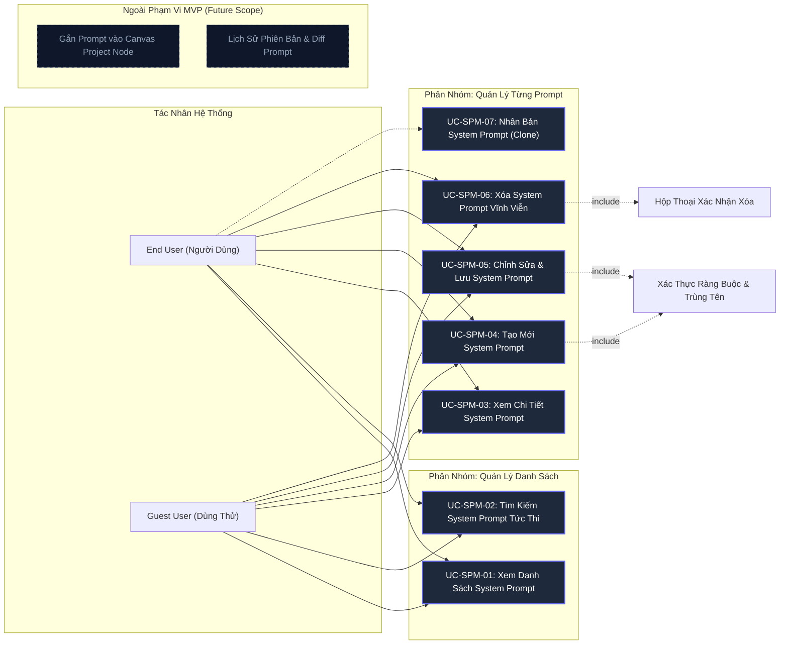
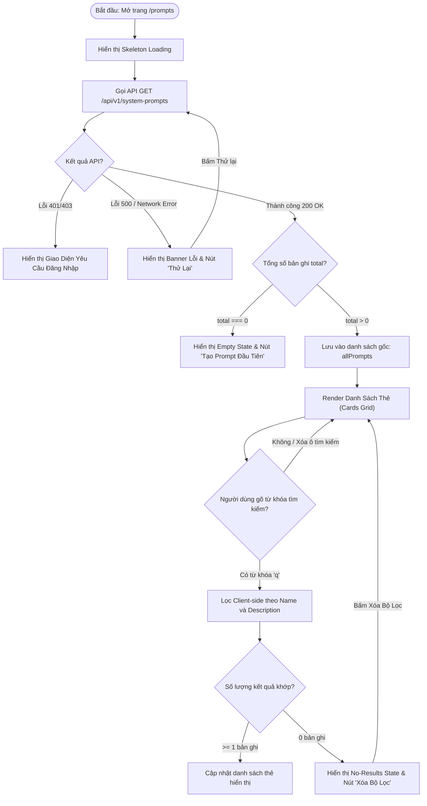
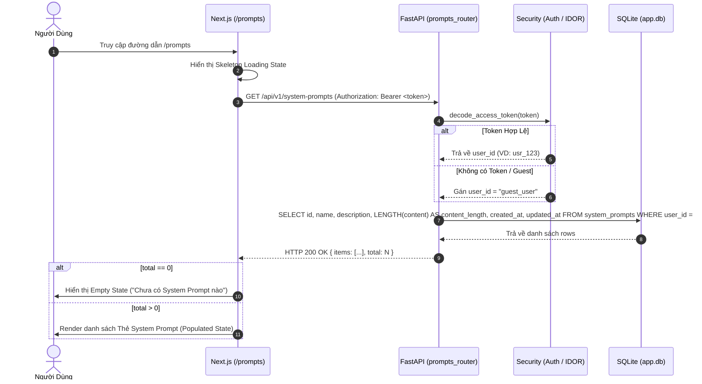
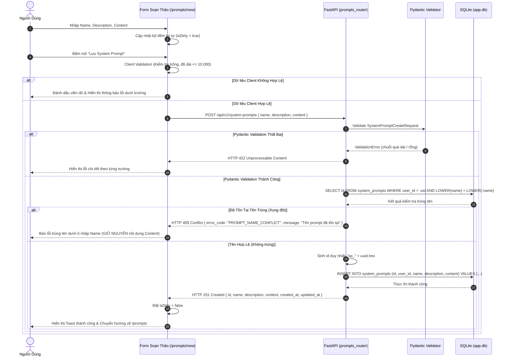
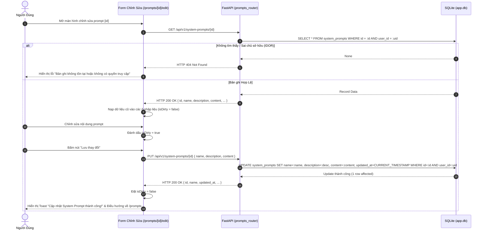
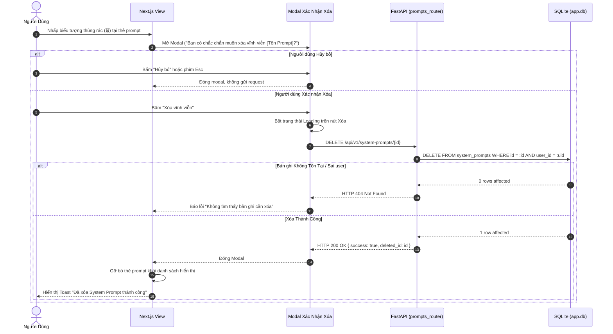
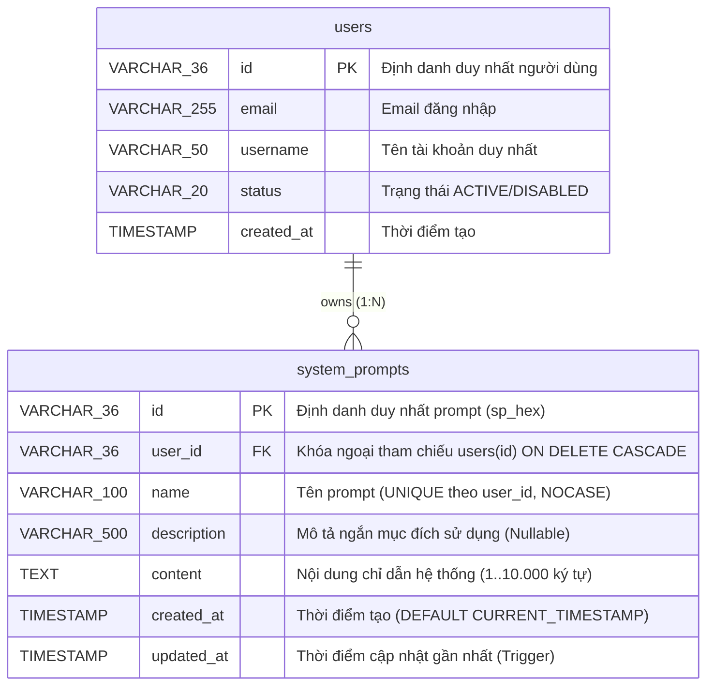
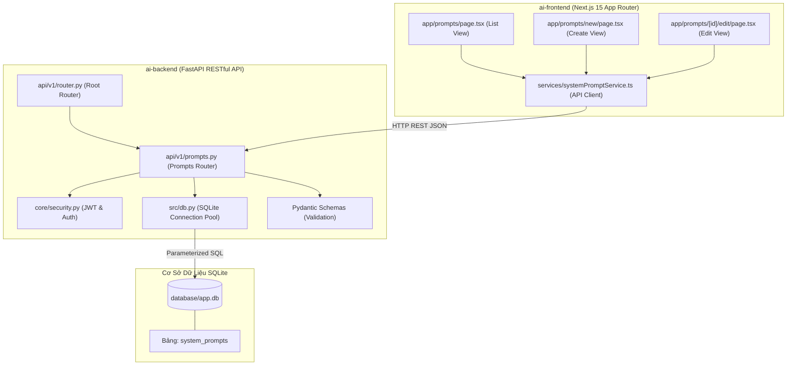
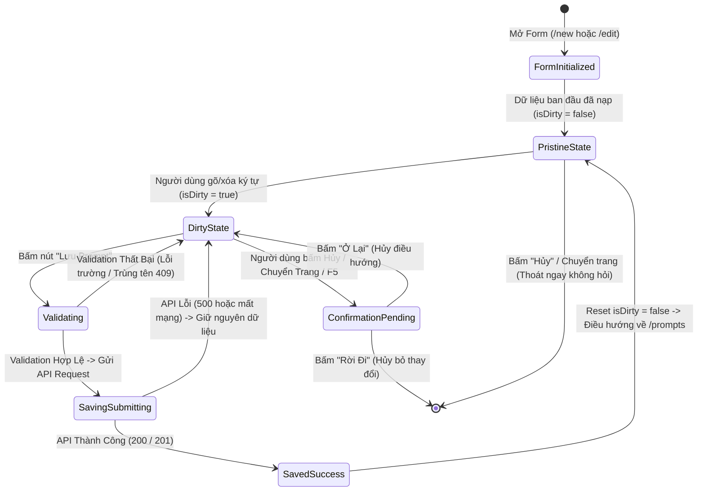

# 07. TẬP HỢP BIỂU ĐỒ MERMAID CHUẨN HÓA (SYSTEM MERMAID DIAGRAMS)
## Phân Hệ: Quản Lý System Prompt (System Prompt Management MVP)
### Nền Tảng: AI-Chan Virtual Assistant Platform

---

| Thông Tin Tài Liệu | Chi Tiết |
| :--- | :--- |
| **Mã Tài Liệu** | `DOC-SPM-07` |
| **Trạng Thái** | `PROPOSED (Chờ Duyệt Từ Solution Architect)` |
| **Vai Trò Phụ Trách** | Solution Architect & System Engineer |
| **Phiên Bản** | `1.0.0-MVP` |
| **Ngày Lập** | `2026-10-11` |

---

Tài liệu này tập hợp **12 biểu đồ Mermaid chuẩn hóa** mô tả trực quan và chính xác toàn bộ kiến trúc, luồng xử lý, tương tác dữ liệu và kiểm soát an toàn của phân hệ Quản lý System Prompt. Tất cả các biểu đồ đều tuân thủ nghiêm ngặt cú pháp Mermaid hợp lệ, đồng bộ mã định danh với SRS, Data Dictionary và API Contract.

---

## 1. Biểu Đồ 01: Use Case Diagram (`DIA-SPM-01`)

- **Mục đích:** Mô tả tổng thể các tác nhân (Actors) và phạm vi các trường hợp sử dụng (Use Cases) trong phân hệ Quản lý System Prompt, thể hiện rõ các tính năng MVP và tính năng mở rộng.



---

## 2. Biểu Đồ 02: Kiến Trúc Thông Tin & Điều Hướng Người Dùng (`DIA-SPM-02`)

- **Mục đích:** Mô tả hành trình di chuyển của người dùng giữa các trang và cơ chế cảnh báo khi rời trang có dữ liệu chưa lưu (Dirty Form).

```mermaid
flowchart TD
    Start([Trang Chủ / hoặc Trang Chat]) -->|Bấm liên kết System Prompts| ListView["/prompts: Màn Hình Danh Sách"]
    
    ListView -->|Bấm nút '+ Tạo Mới'| CreateView["/prompts/new: Form Tạo Mới"]
    ListView -->|Bấm vào Thẻ Prompt| DetailView["/prompts/{id}: Màn Hình Chi Tiết"]
    ListView -->|Bấm icon Thùng Rác| DeleteModal{"Modal Xác Nhận Xóa"}
    
    DetailView -->|Bấm icon Sửa| EditView["/prompts/{id}/edit: Form Chỉnh Sửa"]
    DetailView -->|Bấm nút 'Quay Lại'| ListView
    
    CreateView -->|Nhập liệu & Bấm 'Lưu'| SaveAction["Gửi API POST Lưu Prompt"]
    EditView -->|Sửa đổi & Bấm 'Lưu'| UpdateAction["Gửi API PUT Lưu Prompt"]
    
    SaveAction -->|Thành công (201)| ListView
    UpdateAction -->|Thành công (200)| DetailView
    
    CreateView -->|Bấm 'Hủy' hoặc Chuyển Trang| CheckDirty1{"Form Đã Sửa Đổi? (isDirty)"}
    EditView -->|Bấm 'Hủy' hoặc Chuyển Trang| CheckDirty2{"Form Đã Sửa Đổi? (isDirty)"}
    
    CheckDirty1 -->|Không| ListView
    CheckDirty2 -->|Không| DetailView
    
    CheckDirty1 -->|Có| WarnModal1["Modal Cảnh Báo Chưa Lưu"]
    CheckDirty2 -->|Có| WarnModal2["Modal Cảnh Báo Chưa Lưu"]
    
    WarnModal1 -->|Bấm 'Ở Lại'| CreateView
    WarnModal1 -->|Bấm 'Rời Đi'| ListView
    
    WarnModal2 -->|Bấm 'Ở Lại'| EditView
    WarnModal2 -->|Bấm 'Rời Đi'| DetailView

    DeleteModal -->|Bấm 'Xác Nhận Xóa'| DeleteAction["Gửi API DELETE"] --> ListView
    DeleteModal -->|Bấm 'Hủy Bỏ'| ListView
```

---

## 3. Biểu Đồ 03: Lưu Đồ Tải & Lọc Danh Sách (`DIA-SPM-03`)

- **Mục đích:** Thể hiện luồng xử lý từ khi gửi request lấy danh sách, các nhánh rẽ lỗi và cơ chế lọc tìm kiếm tức thì trên Client.



---

## 4. Biểu Đồ 04: Sequence Diagram — Xem Danh Sách System Prompt (`DIA-SPM-04`)

- **Mục đích:** Mô tả trình tự trao đổi thông điệp giữa Trình duyệt (Frontend), Controller (FastAPI), Tầng bảo mật (Security Context) và Cơ sở dữ liệu (SQLite) khi tải danh sách.



---

## 5. Biểu Đồ 05: Sequence Diagram — Tạo Mới System Prompt (`DIA-SPM-05`)

- **Mục đích:** Mô tả chi tiết quá trình tạo mới bản ghi, bao gồm xác thực dữ liệu 2 lớp và xử lý ngoại lệ xung đột trùng tên (HTTP 409 Conflict).



---

## 6. Biểu Đồ 06: Sequence Diagram — Chỉnh Sửa & Lưu System Prompt (`DIA-SPM-06`)

- **Mục đích:** Mô tả quy trình nạp dữ liệu cũ, chỉnh sửa, kiểm tra quyền sở hữu và lưu ghi đè dữ liệu mới.



---

## 7. Biểu Đồ 07: Sequence Diagram — Xóa System Prompt (`DIA-SPM-07`)

- **Mục đích:** Mô tả quy trình xóa dứt điểm bản ghi kèm bước xác nhận Modal bắt buộc.



---

## 8. Biểu Đồ 08: Entity-Relationship Diagram (`DIA-SPM-08`)

- **Mục đích:** Định nghĩa cấu trúc thực thể CSDL SQLite, kiểu dữ liệu, các ràng buộc toàn vẹn và quan hệ với bảng Users.



---

## 9. Biểu Đồ 09: Component & Architecture Diagram (`DIA-SPM-09`)

- **Mục đích:** Phác họa kiến trúc các module phần mềm, ranh giới giữa Frontend Next.js, Backend FastAPI và CSDL SQLite.



---

## 10. Biểu Đồ 10: Phân Quyền & Luồng Kiểm Soát Anti-IDOR (`DIA-SPM-10`)

- **Mục đích:** Minh họa cơ chế kiểm tra quyền truy cập ở Backend, bảo vệ tài nguyên người dùng khỏi các cuộc tấn công IDOR / BOLA.

```mermaid
flowchart TD
    Req([Client Request tới Endpoint có {id}]) --> TokenCheck{"Kiểm tra JWT Token"}
    
    TokenCheck -->|Token Hợp Lệ| ExtractUser["Trích xuất user_id từ Payload"]
    TokenCheck -->|Không Token / Hết Hạn| GuestUser["Gán user_id = 'guest_user'"]
    
    ExtractUser --> BuildSQL["Xây dựng câu lệnh SQL cưỡng chế điều kiện user_id"]
    GuestUser --> BuildSQL
    
    BuildSQL --> Query["SELECT / UPDATE / DELETE ... WHERE id = :id AND user_id = :user_id"]
    
    Query --> ExecDB[(Thực thi trên SQLite)]
    
    ExecDB --> MatchCheck{"Có bản ghi khớp đồng thời cả id VÀ user_id?"}
    
    MatchCheck -->|Có khớp| Success["Thực hiện thao tác & Trả về HTTP 200/201"]
    
    MatchCheck -->|Không khớp| NotFound["Từ chối với HTTP 404 Not Found (Bảo vệ bí mật tồn tại ID)"]

    classDef allow fill:#065f46,stroke:#10b981,color:#fff;
    classDef deny fill:#7f1d1d,stroke:#ef4444,color:#fff;
    class Success allow;
    class NotFound deny;
```

---

## 11. Biểu Đồ 11: Security Data-Flow & Threat Defense (`DIA-SPM-11`)

- **Mục đích:** Mô tả luồng dữ liệu của chuỗi `content` từ biểu mẫu người dùng, qua các chốt chặn kiểm duyệt bảo mật (XSS, DoS, Log Leakage, Injection) đến CSDL và hiển thị an toàn.

```mermaid
flowchart LR
    subgraph Client_Input["1. Nhập Liệu Client"]
        InputContent["Chuỗi Content (Chứa Unicode, Markdown, <script>)"]
    end

    subgraph Client_Defense["2. Chốt Chặn Phía Client"]
        LengthCheck1{"Độ dài <= 10.000?"}
        InputContent --> LengthCheck1
        LengthCheck1 -->|Vượt quá| Block1["Chặn gõ / Đổi viền đỏ"]
    end

    subgraph Network["3. Truyền Tải Mạng"]
        LengthCheck1 -->|Hợp lệ| HTTPS["HTTPS / HTTP REST Payload"]
    end

    subgraph Server_Defense["4. Chốt Chặn Backend"]
        PydanticCheck{"Pydantic Validation (1..10.000)"}
        HTTPS --> PydanticCheck
        PydanticCheck -->|Sai quy chuẩn| HTTP422["Trả về HTTP 422"]
        
        PydanticCheck -->|Hợp lệ| LogPolicy["Log Policy: CHỈ ghi content_length, KHÔNG log content"]
        LogPolicy --> SQLParam["Parameterized Query: '?' (Chống SQL Injection)"]
    end

    subgraph Storage["5. Lưu Trữ CSDL"]
        SQLParam --> DBStore[("SQLite: system_prompts (Lưu Text thuần túy UTF-8)")]
    end

    subgraph Display_Defense["6. Hiển Thị An Toàn (Safe Render)"]
        DBStore --> ReadAPI["API trả về qua JSON"]
        ReadAPI --> ViewText["Render vào <textarea readOnly> hoặc pre-wrap (Vô hiệu hóa thực thi XSS)"]
    end

    classDef safe fill:#1e293b,stroke:#10b981,stroke-width:2px,color:#fff;
    class LogPolicy,SQLParam,ViewText safe;
```



---

## 12. Biểu Đồ 12: Vòng Đời Trạng Thái Biểu Mẫu Soạn Thảo (`DIA-SPM-12`)

- **Mục đích:** Mô tả máy trạng thái (State Machine) của Form Editor, theo dõi cờ `isDirty`, trạng thái lưu và cơ chế xác nhận thoát.


