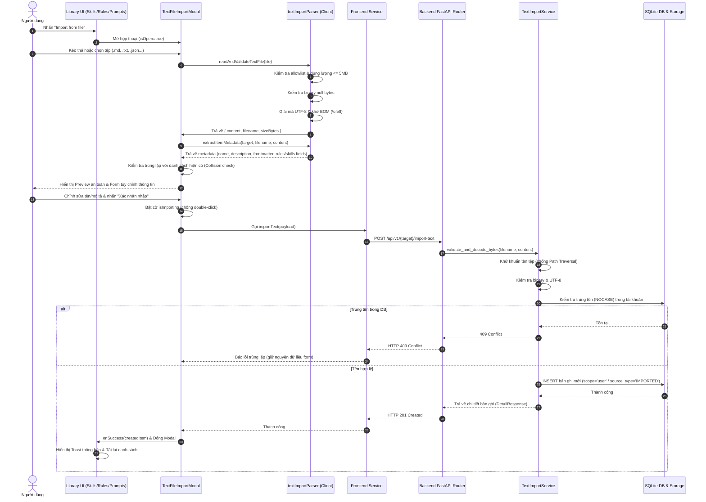

# Đặc Tả Kỹ Thuật: Tính Năng Nhập Tệp Văn Bản (Text File Import) Vào Thư Viện Skills, Rules & System Prompts

**Mã tài liệu**: `FEAT-TXT-IMPORT`  
**Trạng thái**: `IMPLEMENTED`  
**Phiên bản**: `1.0.0`  
**Ngày hoàn thiện**: `18/10/2026`  
**Tác giả**: Antigravity Full-Stack Engineering Team  

---

## 1. Giới Thiệu & Mục Tiêu Nghiệp Vụ

### 1.1 Mục Tiêu Người Dùng
Trong quá trình sử dụng hệ thống AI-Chan, người dùng thường có sẵn các tệp tài liệu kỹ thuật, hướng dẫn chuyên gia (`SKILL.md`), bộ quy tắc kiến trúc (`.md`, `.txt`) hoặc các chỉ dẫn nhân vật/mô hình (`System Prompts`). Thay vì phải mở tệp ngoài hệ thống rồi sao chép - dán thủ công, tính năng **Nhập Tệp Văn Bản (Text File Import)** cho phép:
1. Người dùng chọn tệp từ máy tính cục bộ thông qua hộp thoại chọn tệp chuẩn.
2. Hệ thống kiểm tra an toàn, phân tích cú pháp (frontmatter YAML, tiêu đề, mô tả) và hiển thị bản xem trước an toàn (**Safe Preview**).
3. Người dùng có thể kiểm tra dung lượng, định dạng, chỉnh sửa tên, mô tả và cấu hình trước khi xác nhận.
4. Hệ thống tạo mới một mục tương ứng trong thư viện mục tiêu (**Skills Library**, **Rules Library**, hoặc **System Prompts Library**).
5. Mục vừa nhập sẵn sàng để xem, chỉnh sửa trong Editor hiện có, và áp dụng vào các tác vụ trò chuyện hoặc Project Graph.

### 1.2 Nguyên Tắc Cốt Lõi
- **Tạo mục mới thay vì đính kèm tệp**: Hành động nhập tệp luôn tạo một record độc lập trong thư viện; không biến tệp thành attachment của mục hiện hữu.
- **Xác thực 2 lớp (Client & Server)**: Frontend hỗ trợ trải nghiệm người dùng tức thì; Backend là nguồn xác thực cuối cùng và không tin tưởng dữ liệu client gửi lên.
- **Không thực thi mã**: Dữ liệu tệp được xử lý thuần túy dưới dạng văn bản tĩnh; không chạy script, không nạp URL bên ngoài.
- **Bảo toàn dữ liệu nguồn**: Bảo toàn nguyên vẹn Unicode, xuống dòng, thụt lề và các placeholder template như `{project_context}`, `{input}`.

---

## 2. Phạm Vi Định Dạng Tệp & Giới Hạn Kỹ Thuật

### 2.1 Bảng Allowlist Định Dạng Hỗ Trợ
Chỉ chấp nhận các phần mở rộng tệp văn bản nằm trong danh sách kiểm soát:

| Phần mở rộng | MIME Type Phổ Biến | Mô Tả | Thư Viện Đề Xuất |
| :--- | :--- | :--- | :--- |
| `.md`, `.markdown` | `text/markdown` | Markdown tiêu chuẩn (hỗ trợ YAML frontmatter) | Skills, Rules, Prompts |
| `.txt` | `text/plain` | Văn bản thuần túy | Skills, Rules, Prompts |
| `.rst` | `text/x-rst` | reStructuredText | Rules, Prompts |
| `.json` | `application/json` | JSON dữ liệu/cấu hình | Skills, Rules, Prompts |
| `.yaml`, `.yml` | `text/yaml`, `application/x-yaml` | YAML cấu hình và chỉ dẫn | Skills, Rules, Prompts |
| `.toml` | `application/toml`, `text/plain` | TOML cấu hình | Rules, Prompts |
| `.xml` | `application/xml`, `text/xml` | XML cấu trúc dữ liệu | Rules, Prompts |
| `.csv` | `text/csv` | Dữ liệu dạng bảng phân tách bằng dấu phẩy | Rules, Prompts |

> [!CAUTION]
> **Từ chối nhị phân & thực thi**: Bất kỳ tệp nào chứa byte `0x00` (null byte) hoặc có tỉ lệ ký tự điều khiển (control characters) vượt quá 30% trong 4KB đầu tiên đều bị từ chối ngay lập tức, kể cả khi người dùng cố tình đổi đuôi tệp thành `.txt` hoặc `.md`.

### 2.2 Giới Hạn Dung Lượng & Ký Tự
- **Dung lượng tệp tối đa**: 5 MB (`5,242,880 bytes`). Tệp vượt quá giới hạn sẽ trả về HTTP `413 Request Entity Too Large`.
- **Độ dài ký tự lưu trữ**:
  - **Rules**: Tối đa 10.000 ký tự (theo `RuleCreateRequest`).
  - **System Prompts**: Tối đa 10.000 ký tự (theo `SystemPromptCreateRequest`).
  - **Skills**: Không giới hạn 10.000 ký tự cho body Markdown, tuân thủ Agent Skills Specification.
- **Xử lý mã hóa**: Hỗ trợ đầy đủ UTF-8 tiêu chuẩn và UTF-8 BOM (`\xef\xbb\xbf` / `\ufeff`). Ký tự BOM được tự động khử sạch trước khi phân tích cú pháp.

---

## 3. Kiến Trúc & Luồng Dữ Liệu (Architecture & Sequence Diagram)

### 3.1 Sơ Đồ Kiến Trúc Hệ Thống

```
+-------------------------------------------------------------------------------------------------+
|                                          FRONTEND (Next.js)                                     |
|                                                                                                 |
|   SkillsListPage                 RulesListPage                 SystemPromptsListPage            |
|       [ Import from file ]          [ Nhập Từ Tệp ]                [ Import from file ]         |
|              \                             |                             /                      |
|               +----------------------------+----------------------------+                       |
|                                            |                                                    |
|                                            v                                                    |
|                       +------------------------------------------+                              |
|                       |        TextFileImportModal.tsx           |                              |
|                       | - Local Drag & Drop / File Picker        |                              |
|                       | - File Info Chip (Size, Ext, BOM)        |                              |
|                       | - Collision Alert (Duplicate warning)    |                              |
|                       | - Metadata Editor & Validation           |                              |
|                       | - SafeMarkdownViewer (Anti-XSS Preview)  |                              |
|                       +--------------------+---------------------+                              |
|                                            |                                                    |
|                       +--------------------v---------------------+                              |
|                       |         textImportParser.ts              |                              |
|                       | - Extension Allowlist & Size Check       |                              |
|                       | - isBinaryBuffer (Null byte detection)   |                              |
|                       | - splitFrontmatterAndBody                |                              |
|                       | - toKebabCase & Metadata Extraction      |                              |
|                       +--------------------+---------------------+                              |
|                                            |                                                    |
|                     SkillService      RuleService      SystemPromptService                      |
+--------------------------|-----------------|-------------------|--------------------------------+
                           |                 |                   |
                           | HTTP POST (JSON)| HTTP POST (JSON)  | HTTP POST (JSON)
                           v                 v                   v
+-------------------------------------------------------------------------------------------------+
|                                     BACKEND (FastAPI API v1)                                     |
|                                                                                                 |
|   POST /skills/import-text        POST /rules/import-text        POST /system-prompts/import-text   |
|   POST /skills/import-file        POST /rules/import-file        POST /system-prompts/import-file   |
|              \                             |                             /                      |
|               +----------------------------+----------------------------+                       |
|                                            |                                                    |
|                                            v                                                    |
|                       +------------------------------------------+                              |
|                       |         TextImportService                |                              |
|                       | - sanitize_filename (Path Traversal guard|                              |
|                       | - validate_and_decode_bytes (UTF-8/BOM)  |                              |
|                       | - is_binary_bytes (Null byte check)      |                              |
|                       | - extract_title_and_frontmatter          |                              |
|                       | - import_skill / import_rule / prompt    |                              |
|                       +--------------------+---------------------+                              |
|                                            |                                                    |
|                       +--------------------+---------------------+                              |
|                       |   Persistence & Storage Engine           |                              |
|                       | - Skills: skills DB table + Filesystem   |                              |
|                       | - Rules: rules DB table (scope='user')   |                              |
|                       | - Prompts: system_prompts DB table       |                              |
|                       +------------------------------------------+                              |
+-------------------------------------------------------------------------------------------------+
```

### 3.2 Mermaid Sequence Diagram: Quy Trình Nhập Tệp Dùng Chung



---

## 4. Đặc Tả Từng Thư Viện Mục Tiêu

### 4.1 Thư Viện Skills (`/skills`)
- **Tên kỹ năng**: Bắt buộc chuẩn hóa theo Agent Skills Specification (`^[a-z0-9]+(-[a-z0-9]+)*$`). Tên tệp hoặc frontmatter `name` được hàm `toKebabCase` chuẩn hóa tự động.
- **Frontmatter**: Hỗ trợ phân tích `name`, `description`, `license`, `compatibility`, `allowed-tools`, `metadata`.
- **Tệp không có frontmatter**: Tên tệp chuyển thành kebab-case làm tên mặc định; nội dung tệp trở thành body Markdown của `SKILL.md`.
- **Lưu trữ vật lý**: Tạo thư mục thực tế tại `ai-backend/data/storage/skills/{user_id}/{name}/SKILL.md` và tạo bản ghi trong bảng `skills` với `source_type = 'IMPORTED'`.

### 4.2 Thư Viện Rules (`/rules`)
- **Tên quy tắc**: 1-100 ký tự. Suy ra từ trường `name`/`title` trong frontmatter, hoặc dòng tiêu đề Markdown đầu tiên (`# ...`), hoặc tên tệp.
- **Phạm vi (Scope)**: Mặc định luôn là `user`. Tuyệt đối không tự động nạp thành System Rule hoặc kích hoạt trên tất cả Project nếu chưa được gán.
- **Chế độ kích hoạt (Activation Mode)**: Hỗ trợ `always_on`, `model_decision`, `glob`, `manual`.
- **Priority & Tags**: Hỗ trợ lấy từ frontmatter hoặc chỉnh sửa trên giao diện.

### 4.3 Thư Viện System Prompts (`/prompts`)
- **Tên prompt**: 1-100 ký tự.
- **Bảo toàn văn bản**: Giữ nguyên vẹn mọi ký tự Unicode (tiếng Việt, tiếng Nhật, emojis), ký tự xuống dòng (`\n`) và các placeholder `{input}`, `{context}`.
- **Lưu trữ**: Thêm bản ghi mới vào bảng `system_prompts` với mã định danh `sp_{uuid}`.

---

## 5. Đánh Giá An Ninh & Mô Hình Đe Dọa (STRIDE)

| Mã Đe Dọa | Phân Loại STRIDE | Nguy Cơ | Biện Pháp Kiểm Soát Kỹ Thuật (Mitigation) |
| :--- | :--- | :--- | :--- |
| **THR-IMP-001** | Spoofing / Tampering | Tệp nhị phân độc hại giả mạo đuôi `.txt` hoặc `.md` | Hàm `isBinaryBuffer` (client) và `is_binary_bytes` (backend) kiểm tra null byte `0x00` và tỉ lệ ký tự điều khiển trong buffer. |
| **THR-IMP-002** | Tampering / Information Disclosure | Path Traversal qua tên tệp `../../etc/passwd` | `sanitize_filename` sử dụng `os.path.basename` và loại bỏ triệt để ký tự `..`, `/`, `\` trước khi xử lý. |
| **THR-IMP-003** | Tampering (XSS) | Chèn mã JavaScript độc hại trong tệp Markdown preview | Không sử dụng `dangerouslySetInnerHTML`. Thành phần `SafeMarkdownViewer` phân tích token văn bản thuần và render bằng React JSX elements tự động escape HTML. |
| **THR-IMP-004** | Denial of Service (DoS) | Tải lên tệp dung lượng cực lớn làm treo tiến trình | Cưỡng chế giới hạn 5 MB ở cả Client (trước khi đọc buffer) và Server (kiểm tra `len(bytes) <= 5MB` trả về HTTP 413). |
| **THR-IMP-005** | Elevation of Privilege (Anti-IDOR) | Người dùng sửa đổi hoặc ghi đè tài nguyên của tài khoản khác | Mọi thao tác truy vấn và tạo bản ghi đều ép buộc điều kiện `user_id = current_user['id']`. |
| **THR-IMP-006** | Information Disclosure | Log nội dung tệp nhạy cảm khi phát sinh lỗi hệ thống | Ghi log bảo mật có chọn lọc: chỉ log tên tệp đã làm sạch, kích thước và mã lỗi; không log nội dung văn bản thô. |

---

## 6. Hướng Dẫn Sử Dụng Chi Tiết (User Guide)

### Bước 1: Mở thư viện cần nhập
- Điều hướng tới một trong ba trang:
  - **Agent Skills**: `/skills`
  - **Rules Library**: `/rules`
  - **System Prompts**: `/prompts`

### Bước 2: Kích hoạt hộp thoại nhập tệp
- Nhấn nút **Import from file** (hoặc **Nhập Từ Tệp**).
- Cửa sổ hộp thoại modal sẽ xuất hiện với khu vực kéo thả tệp.

### Bước 3: Chọn tệp từ máy tính
- Kéo và thả tệp văn bản (`.md`, `.txt`, `.json`, `.yaml`, v.v.) vào vùng chỉ định, hoặc nhấn nút **Chọn tệp từ máy tính**.
- Hệ thống sẽ tự động giải mã UTF-8, gỡ bỏ BOM và phân tích metadata.

### Bước 4: Xem trước và tinh chỉnh (Preview)
- Kiểm tra thông tin tệp: Tên gốc, kích thước, định dạng và trạng thái frontmatter.
- Nếu có cảnh báo trùng tên (banner màu vàng), người dùng nên điều chỉnh tên mục.
- Kiểm tra hoặc chỉnh sửa Tên, Mô tả, Activation Mode (với Rules), hoặc Trạng thái kích hoạt (với Skills).
- Xem trước nội dung hiển thị trong tab **Định dạng xem trước** hoặc xem văn bản thô trong tab **Văn bản gốc**.

### Bước 5: Xác nhận nhập
- Nhấn **Xác nhận nhập vào [Mục]**.
- Nút bấm sẽ chuyển sang trạng thái loading để ngăn gửi request trùng lặp.
- Sau khi nhập thành công, modal tự đóng, thông báo toast màu xanh xuất hiện, và danh sách thư viện tự động làm mới để hiển thị mục mới.

---

## 7. Minh Chứng Kiểm Thử & Ma Trận Truy Vết (Test Evidence)

### 7.1 Kiểm Thử Backend (Pytest)
Bộ kiểm thử tích hợp chuyên biệt tại `ai-backend/tests/test_text_file_import.py`:
- `test_01_skills_import_valid_skill_md_utf8_bom`: Nhập SKILL.md có UTF-8 BOM thành công.
- `test_02_skills_import_plain_txt_without_frontmatter`: Nhập file `.txt` không có frontmatter thành Skill kebab-case.
- `test_03_skills_import_text_api`: Nhập Skill qua endpoint JSON `/skills/import-text`.
- `test_04_skills_reject_disallowed_extension_and_binary`: Từ chối đuôi `.exe` và file nhị phân giả mạo.
- `test_05_skills_import_conflict_duplicate_name`: Phát hiện trùng tên trả về HTTP 409.
- `test_06_rules_import_from_file_and_text`: Nhập Rule từ file markdown và qua `/rules/import-text`.
- `test_07_rules_reject_binary`: Từ chối file nhị phân trong Rules Library.
- `test_08_system_prompts_import_unicode_and_placeholders`: Bảo toàn tiếng Việt, emoji, template placeholder.
- `test_09_system_prompts_import_text_api`: Nhập System Prompt qua `/system-prompts/import-text`.
- `test_10_user_isolation`: Kiểm tra cách ly Anti-IDOR giữa các tài khoản người dùng.

**Kết quả kiểm thử Backend**: **43/43 tests PASSED** (Bao gồm 10 test import mới + 33 test hồi quy của Skills, Rules, System Prompts).

### 7.2 Kiểm Thử Frontend (Node Test Runner)
Bộ kiểm thử đơn vị tại `ai-frontend/src/tests/textFileImport.test.ts`:
- Kiểm tra Allowlist 10 định dạng và giới hạn 5 MB.
- Kiểm tra phát hiện byte nhị phân null bytes và control characters.
- Kiểm tra phân tách YAML frontmatter và body.
- Kiểm tra chuẩn hóa `toKebabCase`.
- Kiểm tra trích xuất metadata cho Skills, Rules, Prompts.
- Kiểm tra thuật toán phát hiện trùng tên (Collision check).

**Kết quả kiểm thử Frontend**: **61/61 tests PASSED** (Bao gồm 8 test import mới + 53 test hồi quy hệ thống).

### 7.3 Kiểm Thử TypeScript Compiler
Lệnh thực thi: `npx tsc --noEmit`  
**Kết quả**: **0 errors** (Clean compilation).
