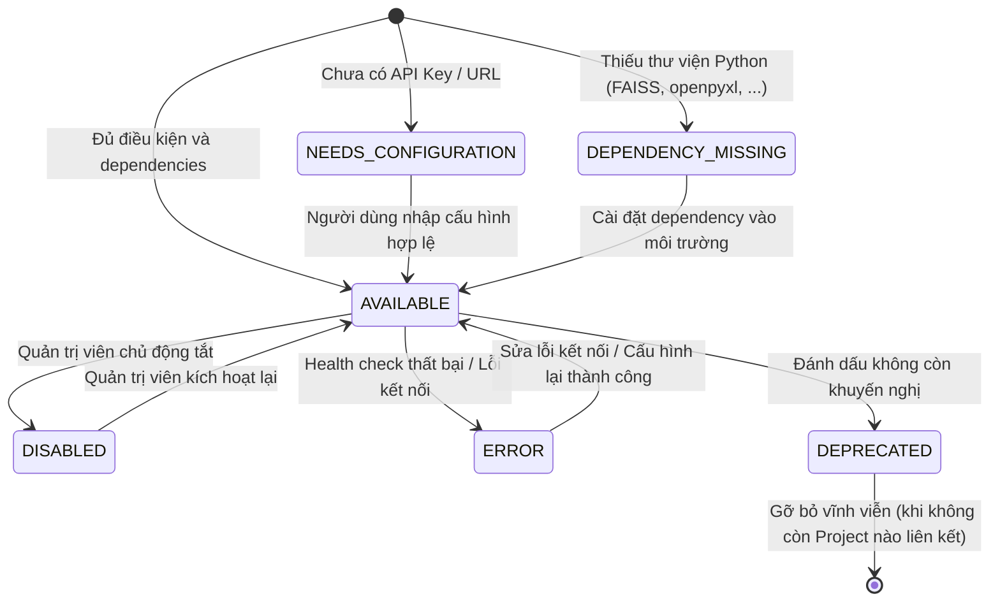
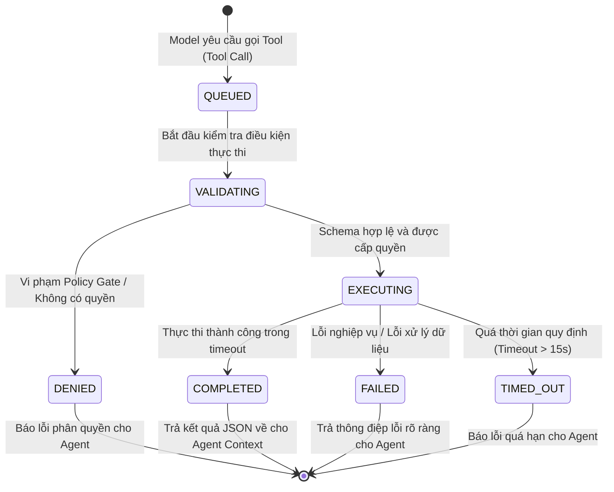

# 01 - Bảng Kiểm kê Tính năng và Phạm vi (Feature Inventory & Scope)

## 1. Bảng Kiểm kê Tính năng Toàn diện (Feature Inventory)

Hệ thống **Tool Management** được chia thành 6 mô-đun chức năng chính:

| Mô-đun | Mã Tính năng | Tên Tính năng | Mô tả Nghiệp vụ | Phân loại Phạm vi |
| :--- | :--- | :--- | :--- | :---: |
| **M1: Tool Library (Registry UI)** | `FEAT-REG-01` | Duyệt danh mục Tools | Hiển thị danh sách tất cả các tools trong hệ thống dưới dạng thẻ trực quan (Card) hoặc bảng (Table). | **MVP** |
| | `FEAT-REG-02` | Tìm kiếm & Lọc nâng cao | Tìm kiếm theo tên, mô tả, tag; lọc theo nhóm (`Web`, `File`, `FAISS`, `Utility`), trạng thái, mức độ rủi ro (`LOW`, `MEDIUM`, `HIGH`). | **MVP** |
| | `FEAT-REG-03` | Chỉ báo trạng thái thời gian thực | Hiển thị badge trạng thái chính xác: `AVAILABLE`, `NEEDS_CONFIGURATION`, `DEPENDENCY_MISSING`, `DISABLED`, `ERROR`, `DEPRECATED`. | **MVP** |
| | `FEAT-REG-04` | Phân trang & Sắp xếp | Sắp xếp theo tên, nhóm, tần suất sử dụng, ngày cập nhật; hỗ trợ phân trang chuẩn UX. | **MVP** |
| **M2: Tool Detail & Lifecycle** | `FEAT-DET-01` | Xem chi tiết Tool | Hiển thị thông số kỹ thuật, phiên bản, tác giả, quyền yêu cầu, timeout, retry policy và tài liệu hướng dẫn. | **MVP** |
| | `FEAT-DET-02` | Xem trước JSON Schema | Render tương tác Input Schema và Output Schema với mô tả trường và ví dụ minh họa (Schema Inspector). | **MVP** |
| | `FEAT-DET-03` | Cấu hình & Quản lý Secrets | Cho phép người dùng chỉnh sửa cấu hình (API URL, tham số); lưu trữ API key/tokens trong kho an toàn tách biệt. | **MVP** |
| | `FEAT-DET-04` | Kiểm tra kết nối (Health Check) | Chạy thử nghiệm ping hoặc gọi test với payload mẫu để xác nhận Tool hoạt động tốt trước khi đưa vào workflow. | **MVP** |
| | `FEAT-DET-05` | Kích hoạt / Vô hiệu hóa (Enable/Disable) | Chuyển đổi trạng thái bật/tắt tool theo phạm vi toàn hệ thống hoặc theo từng người dùng. | **MVP** |
| | `FEAT-DET-06` | Khấu hao & Xóa (Deprecate / Retire) | Đánh dấu lỗi thời hoặc xóa tool; có cơ chế kiểm tra phụ thuộc (không cho xóa tool đang được Project Graph sử dụng). | **MVP** |
| **M3: Tool Execution Engine** | `FEAT-EXE-01` | Bộ điều phối trung tâm (Dispatcher) | Tiếp nhận yêu cầu gọi hàm từ mô hình AI, định tuyến tới adapter tool tương ứng thông qua registry thống nhất. | **MVP** |
| | `FEAT-EXE-02` | Policy Gate & Cấp quyền | Kiểm tra danh sách cho phép (Allowlist), xác minh quyền người dùng, và chặn các thao tác vượt thẩm quyền. | **MVP** |
| | `FEAT-EXE-03` | Giám sát Timeout & Retry | Áp dụng giới hạn thời gian thực thi (mặc định 15s), tự động thử lại có kiểm soát với các lỗi mạng tạm thời. | **MVP** |
| | `FEAT-EXE-04` | Giới hạn Payload & Token Budget | Giới hạn dung lượng kết quả trả về (tối đa 1MB / 10.000 ký tự) để tránh làm tràn context window của LLM. | **MVP** |
| | `FEAT-EXE-05` | Nhật ký thực thi (Execution Audit) | Ghi nhận thời gian, mã trạng thái, số token tiêu thụ, lỗi (nếu có); làm sạch hoàn toàn dữ liệu nhạy cảm khỏi log. | **MVP** |
| **M4: Project Graph Integration** | `FEAT-INT-01` | Ràng buộc Tool vào Project | Cho phép liên kết một hoặc nhiều tools vào cấu hình của một Project mà không làm thay đổi các Project khác. | **MVP** |
| | `FEAT-INT-02` | Phân giải Năng lực Mô hình (Capability Resolution) | Kiểm tra xem mô hình được gán trong Graph có hỗ trợ Function Calling hay không; đưa ra thông báo rõ ràng nếu không hỗ trợ. | **MVP** |
| | `FEAT-INT-03` | Fallback An toàn | Khi mô hình không hỗ trợ Tool Calling hoặc Tool bị lỗi, trả về phản hồi giải thích rõ ràng thay vì giả lập kết quả. | **MVP** |
| **M5: FAISS Local Vector Store** | `FEAT-VEC-01` | Tạo & Quản lý Index FAISS | Tạo chỉ mục vector cục bộ từ tài liệu của người dùng, phân tách theo kích thước chiều vector (dimension) nghiêm ngặt. | **OPTIONAL_DEPENDENCY** |
| | `FEAT-VEC-02` | Tìm kiếm Ngữ nghĩa (Semantic Search) | Tính toán độ tương đồng cosine / inner product để truy xuất đoạn văn bản liên quan nhất cho câu hỏi của người dùng. | **OPTIONAL_DEPENDENCY** |
| | `FEAT-VEC-03` | Tái tạo Chỉ mục (Index Rebuild) | Tái tạo hoàn toàn index từ các tệp nguồn gốc khi mô hình embedding hoặc cấu hình thay đổi. | **OPTIONAL_DEPENDENCY** |
| **M6: Security Shield** | `FEAT-SEC-01` | Lá chắn Chống SSRF | Chặn truy cập vào dải IP loopback, IP riêng RFC 1918, link-local và cloud metadata trong các tool cào web. | **MVP** |
| | `FEAT-SEC-02` | Chống Path Traversal | Chuẩn hóa đường dẫn tệp, giam giữ phạm vi đọc tệp trong thư mục dữ liệu được cấp phép. | **MVP** |
| | `FEAT-SEC-03` | Chính sách Không Thực thi Shell/Script | Ngăn chặn việc chạy lệnh hệ điều hành hoặc code Python tùy ý; thay thế bằng các parser và evaluator có giới hạn. | **MVP** |

---

## 2. Phân loại Phạm vi Triển khai (Scope Breakdown)

### 2.1 Nhóm MVP (Giai đoạn Triển khai Cốt lõi)
- Giao diện Registry UI (Danh sách, Tìm kiếm, Lọc, Chi tiết).
- Cơ chế quản lý cấu hình và bật/tắt Tool.
- Bộ điều phối thực thi trung tâm `ToolExecutorService` tích hợp LangChain `bind_tools`.
- Nhóm 18 tools tiện ích cơ bản (Data Validation, Utilities, Text/CSV/JSON/PDF Parsing, Safe Web Retrieval với SSRF Shield).
- Cơ chế gắn Tools vào Project Workflow và lưu vết audit log.

### 2.2 Nhóm Phụ thuộc Tùy chọn (`OPTIONAL_DEPENDENCY`)
- Nhóm công cụ FAISS Local Vector Store (`create_faiss_index`, `search_faiss_index`, ...): Cần cài đặt gói `faiss-cpu`.
- Nhóm trích xuất Office formats (`extract_docx_text`, `extract_xlsx_data`): Cần cài đặt `python-docx`, `openpyxl`.
- Nhóm tìm kiếm web mở không API key: Cần cài đặt `duckduckgo-search`.

### 2.3 Nhóm Cần Cấu hình Ngoài (`EXTERNAL_CONFIGURATION_REQUIRED`)
- `web_search` thông qua Google Custom Search Engine, Serper API hoặc Tavily API.
- Cloud Embedding Models (OpenAI `text-embedding-3-small` hoặc Google `text-embedding-004`).

### 2.4 Nhóm Hoãn lại (`DEFERRED` - Post-MVP)
- Sandbox cô lập Docker/gVisor cho phép người dùng viết mã Python tùy ý để tạo Custom Tool.
- Phân cụm Vector Store phân tán (Milvus, Qdrant cluster).
- Quản trị hạn ngạch chi phí tài chính thời gian thực theo từng Tool (Cost Budget Limit per Tool).

---

## 3. Máy Trạng thái Vòng đời Tool (State Machine Definitions)

### 3.1 Trạng thái Khả dụng của Tool (Tool Availability Status)

**Mô tả các trạng thái:**
- **`AVAILABLE`**: Tool sẵn sàng 100% để được gán vào Project và thực thi bởi Model.
- **`NEEDS_CONFIGURATION`**: Tool đã có mã nguồn nhưng yêu cầu khóa bí mật (API Key) hoặc đường dẫn cấu hình trước khi chạy.
- **`DEPENDENCY_MISSING`**: Tool yêu cầu một thư viện phụ trợ chưa được cài đặt trong môi trường host. Giao diện hiển thị nút sao chép lệnh `pip install ...`.
- **`DISABLED`**: Tool bị người dùng hoặc quản trị viên tạm thời vô hiệu hóa.
- **`ERROR`**: Lần kiểm tra kết nối (health check) gần nhất bị thất bại.
- **`DEPRECATED`**: Tool sắp bị loại bỏ; cảnh báo người dùng chuyển sang tool thay thế.

---

### 3.2 Vòng đời Thực thi của Tool (Tool Execution Lifecycle)

