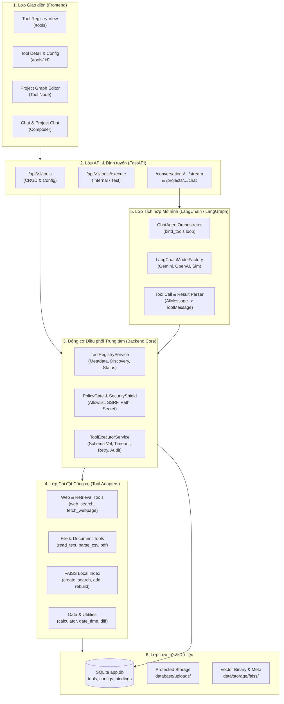
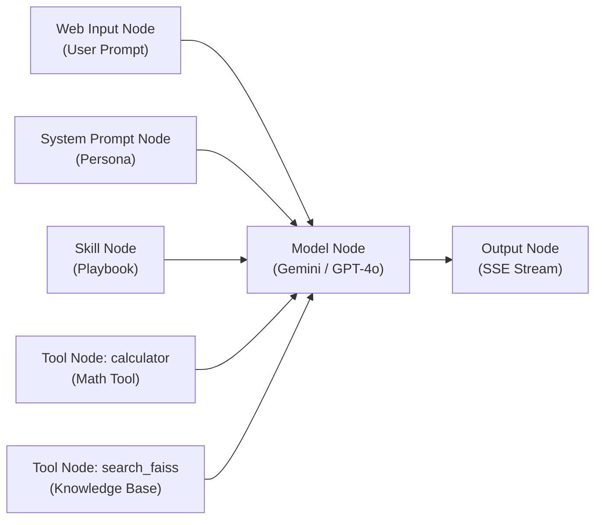
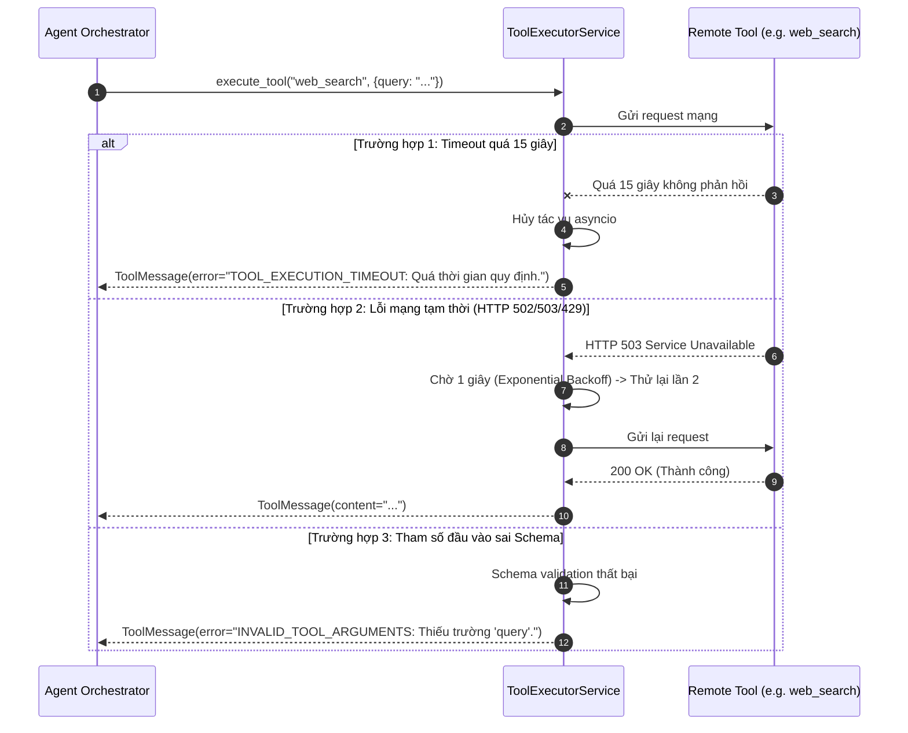

# 04 - Kiến trúc và Vòng đời Thực thi Công cụ (Architecture & Invocation Lifecycle)

## 1. Kiến trúc Tổng thể Hệ thống Tool (System Architecture)

Hệ thống Tool Management được thiết kế theo mô hình phân tầng chặt chẽ (Clean Architecture), tách biệt tuyệt đối giữa **Tầng Định nghĩa (Registry)**, **Tầng Kiểm soát An ninh (Policy Gate)**, **Tầng Thực thi (Executor)**, và **Tầng Tích hợp Mô hình (Model Adapter)**.

---

## 2. Các Thành phần Cốt lõi (Core Components)

### 2.1 `ToolRegistryService` (Bộ Đăng ký & Quản lý Danh mục)
- **Nhiệm vụ:**
  - Khám phá (Discovery) các công cụ có sẵn trong hệ thống khi khởi động.
  - Phân giải trạng thái thời gian thực (`AVAILABLE`, `NEEDS_CONFIGURATION`, `DEPENDENCY_MISSING`, `DISABLED`).
  - Quản lý cấu hình, tham số, và các khóa bí mật của từng người dùng/tenant.
  - Cung cấp danh sách các công cụ đã được chuyển đổi sang đối tượng `BaseTool` của LangChain cho mô hình AI.

### 2.2 `PolicyGate & SecurityShield` (Cổng Kiểm soát An ninh)
- **Nhiệm vụ:**
  - **Kiểm tra Allowlist:** Xác minh công cụ có được cấp quyền trong Project hiện tại hay không (`project_tool_bindings`).
  - **Lá chắn SSRF:** Kiểm tra địa chỉ IP đích trước khi thực hiện request mạng trong `fetch_webpage` và `web_search`.
  - **Chống Path Traversal:** Xác minh tệp đính kèm thuộc quyền sở hữu của người dùng hiện tại (Anti-IDOR) và đường dẫn nằm trong vùng an toàn.
  - **Kiểm tra Mức độ Rủi ro:** Yêu cầu người dùng xác nhận nếu gọi các tool có rủi ro `HIGH` trong kịch bản tương tác.

### 2.3 `ToolExecutorService` (Động cơ Thực thi Công cụ)
- **Nhiệm vụ:**
  - Xác thực tham số đầu vào của mô hình dựa trên **Input JSON Schema** bằng `pydantic` / `jsonschema`.
  - Thực thi tool trong luồng bất đồng bộ (`asyncio.wait_for`) với giới hạn timeout nghiêm ngặt (mặc định 15 giây).
  - Áp dụng chính sách thử lại (Retry Policy) với thuật toán Exponential Backoff cho các lỗi mạng tạm thời.
  - Cắt tỉa kết quả đầu ra (Payload Truncation) để đảm bảo không vượt quá ngân sách 10.000 ký tự.
  - Ghi nhật ký kiểm toán (Audit Logging) vào bảng `tool_executions`.

---

## 3. Cơ chế Tích hợp Project Graph & Năng lực Mô hình

### 3.1 Mô hình Đồ thị Project Graph với Node Tool
Trong hệ thống Project Graph hiện hữu của AI-Chan, các Node bao gồm: `web_input` -> `system_prompt` -> `model` -> `output`.
Hệ thống Tool Management mở rộng kiến trúc với **Node Loại `tool`**:

- **Quy tắc Binding:**
  - Một Project có thể liên kết với 0, 1 hoặc nhiều Tools thông qua bảng quan hệ `project_tool_bindings`.
  - Nếu Project không gắn bất kỳ Tool nào, luồng chat chạy bình thường như hiện tại (không thay đổi hành vi cũ).
  - Khi một Tool bị xóa hoặc vô hiệu hóa, Project Graph vẫn giữ nguyên cấu trúc nhưng trạng thái node Tool sẽ hiển thị cảnh báo `Tool Disabled`.

### 3.2 Phân giải Năng lực Mô hình (Capability Resolution Matrix)

| Mô hình AI | Nhà cung cấp | Hỗ trợ Function / Tool Calling | Cơ chế Tích hợp trong AI-Chan |
| :--- | :--- | :---: | :--- |
| `gemini-2.5-flash` `gemini-3.8-flash` `gemini-2.5-pro` | Google | **CÓ (Native)** | Sử dụng `ChatGoogleGenerativeAI.bind_tools(tools)` |
| `gpt-4o` `gpt-4o-mini` | OpenAI | **CÓ (Native)** | Sử dụng `ChatOpenAI.bind_tools(tools)` |
| `claude-3-5-sonnet` | Anthropic | **CÓ (Native)** | Sử dụng `ChatAnthropic.bind_tools(tools)` |
| `ollama/*` | Cục bộ / Ollama | **TÙY MÔ HÌNH** | Tự động kiểm tra capability qua metadata model |
| `mock-agent` `local-sim` | Local Simulator | **MÔ PHỎNG** | Trả về thông báo phân tích công cụ phục vụ kiểm thử |

### 3.3 Chiến lược Fallback khi Mô hình Không hỗ trợ Tool Calling
Nếu người dùng cấu hình một mô hình không hỗ trợ Function Calling trong Project Graph nhưng lại nối với Tool Node:
1. Hệ thống **tuyệt đối không giả lập việc thực thi thành công**.
2. Tại thời điểm lưu Project hoặc khi bắt đầu lượt chat, hệ thống gửi thông báo cảnh báo:
   > *"Mô hình {model_id} hiện không hỗ trợ tính năng Tool Calling. Các công cụ đã gắn sẽ không được kích hoạt tự động. Vui lòng chuyển sang Gemini 2.5 Flash hoặc GPT-4o mini để sử dụng đầy đủ chức năng."*
3. Lượt chat vẫn được chuyển tới mô hình ở chế độ văn bản thuần túy (Plain Text Generation) mà không làm sập ứng dụng.

---

## 4. Vòng đời Điều phối Thực thi (Invocation Lifecycle Sequence)

```mermaid
sequenceDiagram
    autonumber
    actor User as Người dùng
    participant ChatAPI as Chat / Project API
    participant Agent as LangChain Agent Loop
    participant Model as LLM Provider (Gemini / OpenAI)
    participant Gate as PolicyGate & SecurityShield
    participant Exec as ToolExecutorService
    participant Tool as Tool Adapter Function
    participant Audit as Tool Execution Audit Log

    User->>ChatAPI: Gửi prompt: "Tính căn bậc hai của 144 và tìm web về AI-Chan"
    ChatAPI->>Agent: astream_agent(prompt, history, project_id)
    
    Agent->>Gate: Lấy danh sách Tools được phép cho Project (Allowlist)
    Gate-->>Agent: Trả về danh sách [calculator, web_search]
    Agent->>Model: Gửi messages kèm model.bind_tools([calculator, web_search])
    
    Model-->>Agent: Trả về AIMessage với tool_calls:<br/>[call_1: calculator(expression="sqrt(144)")]
    
    rect rgb(30, 40, 50)
        Note over Agent,Exec: Vòng lặp Thực thi Tool (Tool Calling Loop)
        Agent->>Gate: Xác thực quyền gọi tool 'calculator'
        Gate-->>Agent: Quyền hợp lệ (Policy PASSED)
        
        Agent->>Exec: execute_tool("calculator", {"expression": "sqrt(144)"})
        Exec->>Exec: Validate Input JSON Schema
        Exec->>Tool: Chạy hàm tính toán (In-memory, Timeout 15s)
        Tool-->>Exec: Kết quả: {"result": 12.0}
        Exec->>Exec: Kiểm tra kích thước output (<10KB)
        Exec->>Audit: Ghi log thực thi (duration_ms: 12ms, status: COMPLETED)
        Exec-->>Agent: Trả về ToolMessage(content='{"result": 12.0}', tool_call_id="call_1")
    end

    Agent->>Model: Gửi lại toàn bộ hội thoại + ToolMessage kết quả
    Model-->>Agent: Sinh token hoàn chỉnh: "Căn bậc hai của 144 là 12."
    Agent-->>ChatAPI: Yield SSE stream tokens
    ChatAPI-->>User: Hiển thị phản hồi thời gian thực trên giao diện
```

---

## 5. Xử lý Lỗi, Timeout và Thử lại (Error Handling & Resiliency)

