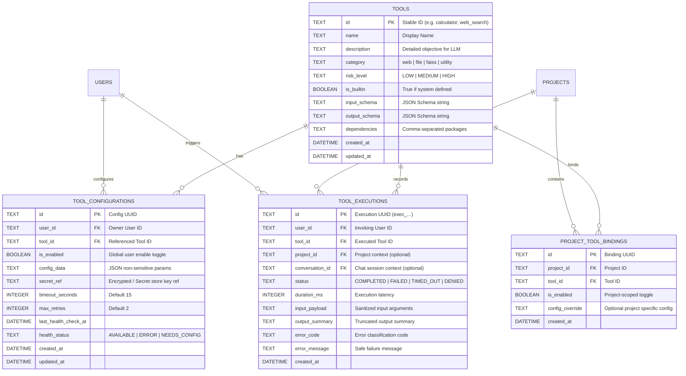

# 05 - Mô hình Dữ liệu và Hợp đồng API Đề xuất (Data Model & API Contracts)

## 1. Mô hình Dữ liệu Thực thể (Entity Relationship Diagram)



---

## 2. Đặc tả Cấu trúc Bảng Cơ sở Dữ liệu Đề xuất (Proposed DDL)

```sql
-- 1. Bảng danh mục định nghĩa Tool (Metadata Registry)
CREATE TABLE IF NOT EXISTS tools (
    id TEXT PRIMARY KEY,
    name TEXT NOT NULL,
    description TEXT NOT NULL,
    category TEXT NOT NULL CHECK(category IN ('web', 'file', 'faiss', 'utility')),
    risk_level TEXT NOT NULL CHECK(risk_level IN ('LOW', 'MEDIUM', 'HIGH')),
    is_builtin BOOLEAN NOT NULL DEFAULT 1,
    input_schema TEXT NOT NULL,
    output_schema TEXT NOT NULL,
    dependencies TEXT,
    created_at DATETIME DEFAULT CURRENT_TIMESTAMP,
    updated_at DATETIME DEFAULT CURRENT_TIMESTAMP
);

-- 2. Bảng cấu hình Tool theo người dùng / tenant
CREATE TABLE IF NOT EXISTS tool_configurations (
    id TEXT PRIMARY KEY,
    user_id TEXT NOT NULL,
    tool_id TEXT NOT NULL,
    is_enabled BOOLEAN NOT NULL DEFAULT 1,
    config_data TEXT DEFAULT '{}',
    secret_ref TEXT,
    timeout_seconds INTEGER NOT NULL DEFAULT 15,
    max_retries INTEGER NOT NULL DEFAULT 2,
    last_health_check_at DATETIME,
    health_status TEXT NOT NULL DEFAULT 'AVAILABLE',
    created_at DATETIME DEFAULT CURRENT_TIMESTAMP,
    updated_at DATETIME DEFAULT CURRENT_TIMESTAMP,
    FOREIGN KEY(tool_id) REFERENCES tools(id) ON DELETE CASCADE,
    UNIQUE(user_id, tool_id)
);

-- 3. Bảng ràng buộc Tool vào Project Workflow
CREATE TABLE IF NOT EXISTS project_tool_bindings (
    id TEXT PRIMARY KEY,
    project_id TEXT NOT NULL,
    tool_id TEXT NOT NULL,
    is_enabled BOOLEAN NOT NULL DEFAULT 1,
    config_override TEXT DEFAULT '{}',
    created_at DATETIME DEFAULT CURRENT_TIMESTAMP,
    FOREIGN KEY(project_id) REFERENCES projects(id) ON DELETE CASCADE,
    FOREIGN KEY(tool_id) REFERENCES tools(id) ON DELETE RESTRICT,
    UNIQUE(project_id, tool_id)
);

-- 4. Bảng nhật ký kiểm toán thực thi (Execution Audit Log)
CREATE TABLE IF NOT EXISTS tool_executions (
    id TEXT PRIMARY KEY,
    user_id TEXT NOT NULL,
    tool_id TEXT NOT NULL,
    project_id TEXT,
    conversation_id TEXT,
    status TEXT NOT NULL CHECK(status IN ('COMPLETED', 'FAILED', 'TIMED_OUT', 'DENIED')),
    duration_ms INTEGER NOT NULL,
    input_payload TEXT,
    output_summary TEXT,
    error_code TEXT,
    error_message TEXT,
    created_at DATETIME DEFAULT CURRENT_TIMESTAMP,
    FOREIGN KEY(tool_id) REFERENCES tools(id) ON DELETE SET NULL
);

CREATE INDEX IF NOT EXISTS idx_tool_executions_user ON tool_executions(user_id);
CREATE INDEX IF NOT EXISTS idx_tool_executions_tool ON tool_executions(tool_id);
CREATE INDEX IF NOT EXISTS idx_project_tool_bindings_proj ON project_tool_bindings(project_id);
```

---

## 3. Đặc tả Hợp đồng REST API Đề xuất (`/api/v1/tools`)

### 3.1 `GET /api/v1/tools`
Lấy danh sách tất cả các tools trong hệ thống kèm trạng thái khả dụng thực tế.
- **Query Parameters:**
  - `category` (optional): `web` | `file` | `faiss` | `utility`
  - `status` (optional): `AVAILABLE` | `NEEDS_CONFIGURATION` | `DEPENDENCY_MISSING` | `DISABLED`
  - `risk` (optional): `LOW` | `MEDIUM` | `HIGH`
  - `q` (optional): Từ khóa tìm kiếm theo tên hoặc mô tả
  - `limit` (int, default 50): Phân trang
  - `offset` (int, default 0): Phân trang
- **Response 200 OK:**
  ```json
  {
    "total": 32,
    "items": [
      {
        "id": "calculator",
        "name": "Máy tính Số học An toàn",
        "category": "utility",
        "risk_level": "LOW",
        "status": "AVAILABLE",
        "is_builtin": true,
        "is_enabled": true,
        "dependencies_met": true,
        "missing_dependencies": [],
        "description": "Thực hiện các phép tính số học chính xác mà không dùng eval.",
        "timeout_seconds": 15
      },
      {
        "id": "search_faiss_index",
        "name": "Tìm kiếm Ngữ nghĩa FAISS",
        "category": "faiss",
        "risk_level": "LOW",
        "status": "DEPENDENCY_MISSING",
        "is_builtin": true,
        "is_enabled": true,
        "dependencies_met": false,
        "missing_dependencies": ["faiss-cpu"],
        "description": "Tìm kiếm đoạn văn bản tương đồng trong vector index cục bộ.",
        "timeout_seconds": 15
      }
    ]
  }
  ```

---

### 3.2 `GET /api/v1/tools/{tool_id}`
Lấy chi tiết một tool kèm đầy đủ định nghĩa JSON Schema input/output và cấu hình hiện tại.
- **Response 200 OK:**
  ```json
  {
    "id": "fetch_webpage",
    "name": "Tải Nội dung Trang Web",
    "category": "web",
    "risk_level": "HIGH",
    "status": "AVAILABLE",
    "is_builtin": true,
    "is_enabled": true,
    "description": "Tải nội dung HTML từ URL công khai với lá chắn chống SSRF.",
    "input_schema": {
      "type": "object",
      "properties": {
        "url": { "type": "string", "format": "uri" }
      },
      "required": ["url"]
    },
    "output_schema": {
      "type": "object",
      "properties": {
        "url": { "type": "string" },
        "status_code": { "type": "integer" },
        "html_content": { "type": "string" }
      }
    },
    "configuration": {
      "timeout_seconds": 8,
      "max_retries": 1,
      "has_secret": false,
      "custom_params": {
        "user_agent": "AI-Chan-Bot/1.0"
      }
    }
  }
  ```
- **Error Codes:** `404 Not Found` nếu ID không tồn tại.

---

### 3.3 `PUT /api/v1/tools/{tool_id}/config`
Cập nhật tham số cấu hình hoặc khóa bí mật của Tool cho người dùng hiện tại.
- **Request Body:**
  ```json
  {
    "is_enabled": true,
    "timeout_seconds": 12,
    "custom_params": {
      "user_agent": "Custom-Agent/2.0"
    },
    "secret_value": "sk-proj-secret-token..."
  }
  ```
- **Response 200 OK:**
  ```json
  {
    "status": "updated",
    "tool_id": "fetch_webpage",
    "health_status": "AVAILABLE"
  }
  ```

---

### 3.4 `POST /api/v1/tools/{tool_id}/test`
Chạy kiểm tra độc lập (Health Check / Connection Test) với payload mẫu.
- **Request Body:**
  ```json
  {
    "payload": {
      "expression": "(45 * 2) + 10"
    }
  }
  ```
- **Response 200 OK:**
  ```json
  {
    "status": "SUCCESS",
    "duration_ms": 14,
    "result": {
      "expression": "(45 * 2) + 10",
      "result": 100,
      "formatted": "100.0"
    }
  }
  ```
- **Response 422 Unprocessable Entity:** Trả về lỗi chi tiết nếu payload không khớp Input Schema.
- **Response 504 Gateway Timeout:** Nếu tool chạy vượt quá timeout quy định.

---

### 3.5 `POST /api/v1/tools/execute` (Internal Tool Execution Dispatcher)
Endpoint nội bộ do Agent Orchestrator gọi khi mô hình AI yêu cầu thực thi Tool.
- **Request Body:**
  ```json
  {
    "tool_id": "calculator",
    "project_id": "proj_12345",
    "conversation_id": "conv_67890",
    "arguments": {
      "expression": "sqrt(256)"
    }
  }
  ```
- **Response 200 OK:**
  ```json
  {
    "tool_id": "calculator",
    "execution_id": "exec_abc123",
    "status": "COMPLETED",
    "duration_ms": 8,
    "output": {
      "result": 16.0
    }
  }
  ```
- **Error Codes:**
  - `403 Forbidden`: `{"error_code": "TOOL_ACCESS_DENIED", "message": "Tool không nằm trong allowlist của Project."}`
  - `422 Unprocessable Entity`: `{"error_code": "INVALID_TOOL_ARGUMENTS", "message": "Tham số không khớp Schema."}`
  - `504 Gateway Timeout`: `{"error_code": "TOOL_EXECUTION_TIMEOUT", "message": "Thời gian thực thi vượt quá 15 giây."}`
