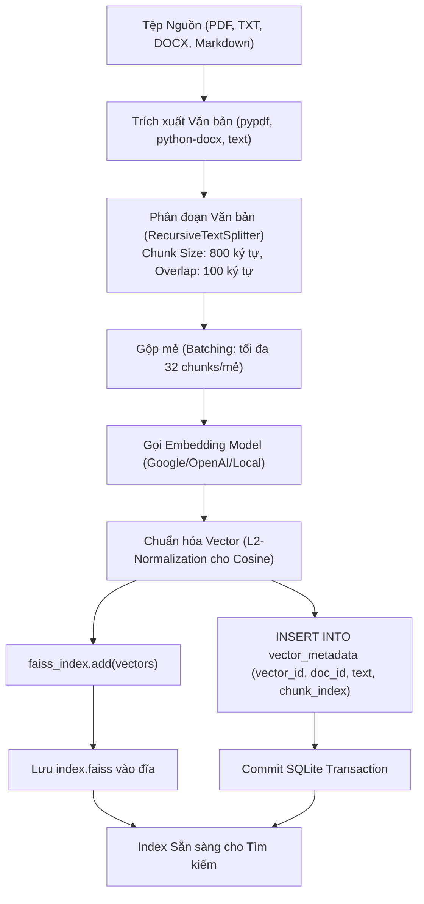

# 07 - Đặc tả Chuyên sâu FAISS Local Vector Store (FAISS Subsystem Specification)

## 1. Bản chất Kỹ thuật và Vai trò của FAISS

**FAISS (Facebook AI Similarity Search)** là một thư viện C++ mã nguồn mở hiệu năng cao được thiết kế để tìm kiếm độ tương đồng giữa các vector mật độ cao (dense vectors) trong không gian nhiều chiều.

> [!IMPORTANT]
> **Nguyên tắc Cốt lõi về FAISS:**
> 1. **FAISS không tự tạo Embeddings:** FAISS chỉ là cấu trúc dữ liệu lập chỉ mục (Index) và thuật toán tính khoảng cách vector; nó **không có khả năng hiểu văn bản thô**. Để đưa văn bản vào FAISS, hệ thống bắt buộc phải đi qua một mô hình Embedding (Google, OpenAI hoặc mô hình cục bộ).
> 2. **Index nhị phân không phải là Nguồn Chân lý duy nhất:** File nhị phân `index.faiss` có thể bị hỏng hoặc mất đồng bộ. **Nguồn chân lý gốc luôn là các tệp tài liệu văn bản ban đầu** được lưu trong hệ thống attachments của người dùng.
> 3. **Quy tắc Cách ly Kích thước Chiều (Dimensional Isolation):** Tuyệt đối không được trộn các vector có số chiều khác nhau (ví dụ 768d của Google và 1536d của OpenAI) hoặc sinh từ các mô hình embedding khác nhau vào cùng một index.

---

## 2. Ma trận Mô hình Embedding và Kích thước Chiều (Dimension Matrix)

Mỗi FAISS Index khi khởi tạo phải được gắn chặt với đúng một cấu hình mô hình embedding duy nhất:

| Nhà cung cấp | Tên Mô hình Embedding | Số chiều Vector (Dimension) | Metric Khoảng cách Khuyến nghị | Ưu điểm & Giới hạn |
| :--- | :--- | :---: | :---: | :--- |
| **Google** | `text-embedding-004` | **768** | `Inner Product` (Cosine) | Tối ưu chi phí, chất lượng ngữ nghĩa tiếng Việt và tiếng Anh rất tốt. Cần Google API Key. |
| **OpenAI** | `text-embedding-3-small` | **1536** | `Inner Product` (Cosine) | Khả năng phân tách ngữ nghĩa xuất sắc, độ ổn định toàn cầu cao. Cần OpenAI API Key. |
| **Local CPU (FastEmbed)** | `BAAI/bge-small-en-v1.5`<br>`keepitreal/vietnamese-bi-encoder` | **384** | `Inner Product` (Cosine) | **Chạy 100% Offline cục bộ**, không tốn tiền API, không lo lộ dữ liệu ra ngoài. Yêu cầu RAM host. |

---

## 3. Cấu trúc Lưu trữ và Siêu dữ liệu (Storage Layout & Metadata Store)

Mỗi FAISS Index thuộc về một người dùng cụ thể và được lưu trữ độc lập trong thư mục bảo vệ:

```
data/storage/faiss/{user_id}/{index_name}/
├── config.json         # Metadata: embedding_provider, model_name, dimension, metric, created_at
├── index.faiss         # File nhị phân lưu trữ chỉ mục vector của FAISS C++
└── metadata.sqlite     # CSDL SQLite cục bộ lưu văn bản tương ứng với từng vector ID
```

### 3.1 Cấu trúc Bảng `metadata.sqlite` Cục bộ
Do file `index.faiss` chỉ lưu các mảng số thực và ID số nguyên liên tiếp (`0, 1, 2, ... N-1`), một CSDL SQLite nhỏ đi kèm được sử dụng để ánh xạ vector ID với văn bản thực tế:

```sql
CREATE TABLE IF NOT EXISTS vector_metadata (
    vector_id INTEGER PRIMARY KEY,         -- Khớp chính xác với thứ tự vector trong FAISS
    doc_id TEXT NOT NULL,                  -- ID định danh tài liệu nghiệp vụ
    source_attachment_id TEXT,             -- Liên kết tới bảng attachments của AI-Chan
    chunk_index INTEGER NOT NULL,          -- Thứ tự đoạn trong tài liệu gốc
    text_content TEXT NOT NULL,            -- Nội dung văn bản thực tế để trả về cho Agent
    token_count INTEGER,                   -- Số lượng token ước tính
    created_at DATETIME DEFAULT CURRENT_TIMESTAMP
);

CREATE INDEX IF NOT EXISTS idx_doc_id ON vector_metadata(doc_id);
```

---

## 4. Quy trình Nạp Tài liệu và Đánh Chỉ mục (Ingestion Pipeline)



---

## 5. Quy trình Tìm kiếm Ngữ nghĩa (Semantic Search Flow)

Khi công cụ `search_faiss_index` được gọi:
1. Nhận câu hỏi `query` từ người dùng hoặc Agent.
2. Kiểm tra `index_name` có tồn tại trong kho của `user_id` hiện tại hay không (Anti-IDOR).
3. Đọc `config.json` để lấy đúng mô hình embedding đã khởi tạo index (ví dụ: Google 768d).
4. Chuyển `query` thành vector 768d thông qua cùng mô hình embedding đó và chuẩn hóa L2 vector.
5. Gọi `faiss_index.search(query_vector, top_k)`:
   - Nhận về mảng khoảng cách `distances` và mảng chỉ số `indices`.
6. Truy vấn `metadata.sqlite`:
   - `SELECT doc_id, text_content, chunk_index FROM vector_metadata WHERE vector_id IN (...)`.
7. Lọc theo ngưỡng `score_threshold` (ví dụ `score >= 0.5`).
8. Trả về danh sách kết quả có định dạng JSON chuẩn cho Agent.

---

## 6. Giao thức Tái tạo Chỉ mục (Deterministic Rebuild Protocol)

Khi người dùng muốn thay đổi mô hình embedding (ví dụ chuyển từ OpenAI sang mô hình cục bộ Offline) hoặc khi file `index.faiss` bị lỗi:
1. Đặt trạng thái index sang `REBUILDING` (tạm thời từ chối các lượt tìm kiếm mới).
2. Đọc toàn bộ danh sách `source_attachment_id` gốc từ bảng metadata.
3. Tạo một index FAISS tạm thời mới (`index_temp.faiss`) với mô hình embedding mới.
4. Lặp qua các tệp nguồn, phân đoạn và sinh lại vector cho toàn bộ văn bản.
5. Sau khi hoàn tất 100% không có lỗi, đổi tên hoán đổi (`atomic swap`):
   - Thay thế `index.faiss` cũ bằng file mới.
   - Cập nhật lại `metadata.sqlite`.
6. Chuyển trạng thái index về `AVAILABLE`.

---

## 7. Chiến lược Phụ thuộc Hệ điều hành (OS & Dependency Strategy)

- **Môi trường Windows (Môi trường Dev của User):**
  - Gói `faiss-cpu` cài đặt thông qua `pip install faiss-cpu` chạy trực tiếp trên Windows x64 mà không cần trình biên dịch C++ Visual Studio riêng.
- **Tính năng Tùy chọn (Optional Graceful Degradation):**
  - Mô-đun FAISS được tải dưới dạng **Lazy Import**:
    ```python
    try:
        import faiss
        FAISS_AVAILABLE = True
    except ImportError:
        faiss = None
        FAISS_AVAILABLE = False
    ```
  - Nếu `FAISS_AVAILABLE is False`:
    - Các tool FAISS trong danh mục tự động hiển thị badge `DEPENDENCY_MISSING`.
    - Khi người dùng bấm vào tool, hệ thống hiển thị dòng lệnh hướng dẫn:
      `pip install faiss-cpu`
    - Toàn bộ các chức năng khác của AI-Chan (Chat, Project Graph, Models, Skills, File Upload) **vẫn hoạt động 100% bình thường, tuyệt đối không bị gián đoạn hay crash server**.
