# 08 - Bộ 16 Biểu đồ Kiến trúc và Luồng Thực thi (Mermaid Diagrams Specification)

Hồ sơ này tập hợp đầy đủ **16 biểu đồ Mermaid bắt buộc**, mô hình hóa từ tầng nghiệp vụ, trải nghiệm người dùng, kiến trúc dữ liệu, đến luồng thực thi và kiểm soát an ninh.

---

## 1. Biểu đồ Trường hợp Sử dụng (Use Case Diagram: List & Detail Management)

```mermaid
flowchart TD
    User([Người dùng / Kỹ sư AI])
    Admin([Quản trị viên Hệ thống])

    subgraph Tool_Management_Boundary["Hệ thống Quản lý Tool (AI-Chan)"]
        UC1["UC-01: Duyệt danh mục Tools"]
        UC2["UC-02: Tìm kiếm & Lọc Tools"]
        UC3["UC-03: Xem chi tiết & Schema Inspector"]
        UC4["UC-04: Cấu hình tham số & Khóa API"]
        UC5["UC-05: Kiểm tra kết nối (Health Check)"]
        UC6["UC-06: Bật / Tắt Tool"]
        UC7["UC-07: Gắn Tool vào Project Graph"]
        UC8["UC-08: Xem Nhật ký Thực thi (Audit Log)"]
        UC9["UC-09: Khấu hao Tool (Deprecate / Retire)"]
    end

    User --> UC1
    User --> UC2
    User --> UC3
    User --> UC4
    User --> UC5
    User --> UC6
    User --> UC7
    User --> UC8

    Admin --> UC1
    Admin --> UC4
    Admin --> UC6
    Admin --> UC8
    Admin --> UC9
```

---

## 2. Biểu đồ Luồng Người dùng & Kiến trúc Thông tin (IA / User Flow)

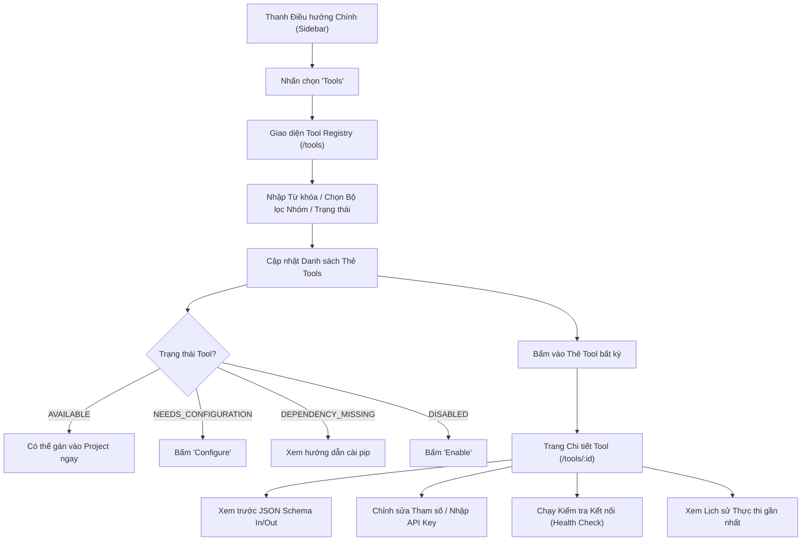

---

## 3. Sơ đồ Tuần tự: Lấy Danh sách Tools (Sequence: List Tools & Status)

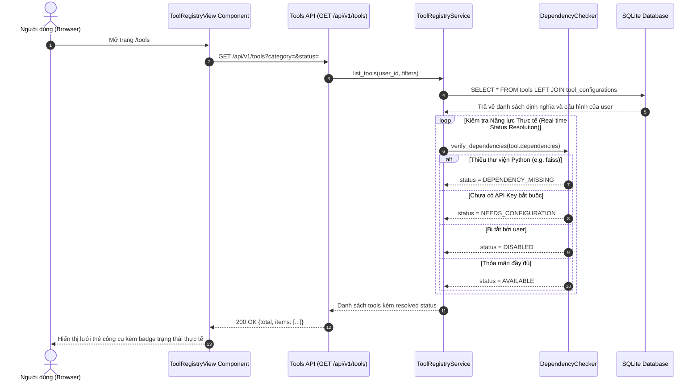

---

## 4. Sơ đồ Tuần tự: Chỉnh sửa và Lưu Cấu hình (Sequence: Edit & Validate Config)

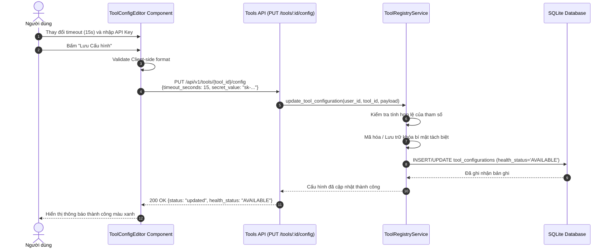

---

## 5. Sơ đồ Tuần tự: Kiểm tra Kết nối Độc lập (Sequence: Health Check / Test Run)

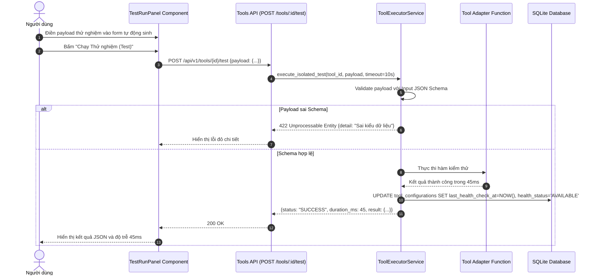

---

## 6. Sơ đồ Tuần tự: Vòng lặp Gọi Tool từ Mô hình (Sequence: Model Tool Calling Loop)

```mermaid
sequenceDiagram
    autonumber
    actor User as Người dùng Chat
    participant Agent as LangChain Agent Orchestrator
    participant Model as LLM Provider (Gemini / OpenAI)
    participant Gate as PolicyGate & SecurityShield
    participant Exec as ToolExecutorService
    participant Tool as Tool Adapter (e.g. calculator)
    participant Audit as Tool Execution Audit Log

    User->>Agent: Gửi câu hỏi: "Cộng 1250 và 8750 rồi nhân 2"
    Agent->>Gate: Lấy danh sách tools được phép trong Project (Allowlist)
    Gate-->>Agent: [calculator]
    
    Agent->>Model: Gửi messages kèm bind_tools([calculator])
    Model-->>Agent: Trả về AIMessage với tool_calls:<br/>[id: call_1, name: "calculator", args: {"expression": "(1250 + 8750) * 2"}]
    
    rect rgb(20, 35, 45)
        Note over Agent,Exec: Tầng Thực thi An toàn (Safe Execution Sandbox)
        Agent->>Gate: Xác thực quyền gọi tool 'calculator'
        Gate-->>Agent: Hợp lệ (Policy Check: PASS)
        
        Agent->>Exec: execute_tool("calculator", args, timeout=15s)
        Exec->>Exec: Validate Input Schema
        Exec->>Tool: Chạy hàm AST toán học an toàn
        Tool-->>Exec: {"result": 20000}
        
        Exec->>Audit: Ghi nhật ký thực thi (COMPLETED, 8ms)
        Exec-->>Agent: Trả về ToolMessage(content='{"result": 20000}', tool_call_id="call_1")
    end

    Agent->>Model: Gửi lại toàn bộ lịch sử + ToolMessage
    Model-->>Agent: Trả về câu trả lời tự nhiên: "Kết quả của phép tính là 20.000."
    Agent-->>User: Hiển thị câu trả lời trên màn hình chat
```

---

## 7. Sơ đồ Tuần tự: Xử lý Lỗi, Quá hạn và Thử lại (Sequence: Error / Timeout / Retry)

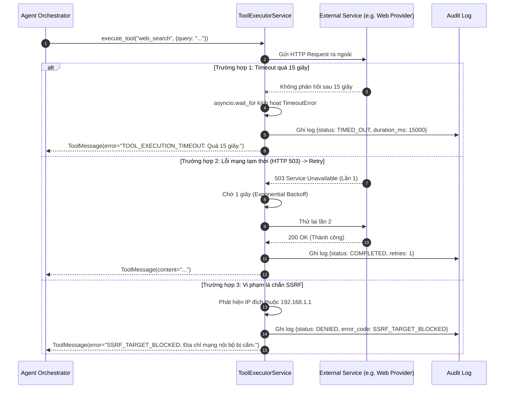

---

## 8. Biểu đồ Trạng thái: Vòng đời Khả dụng của Tool (State Diagram: Tool Lifecycle)

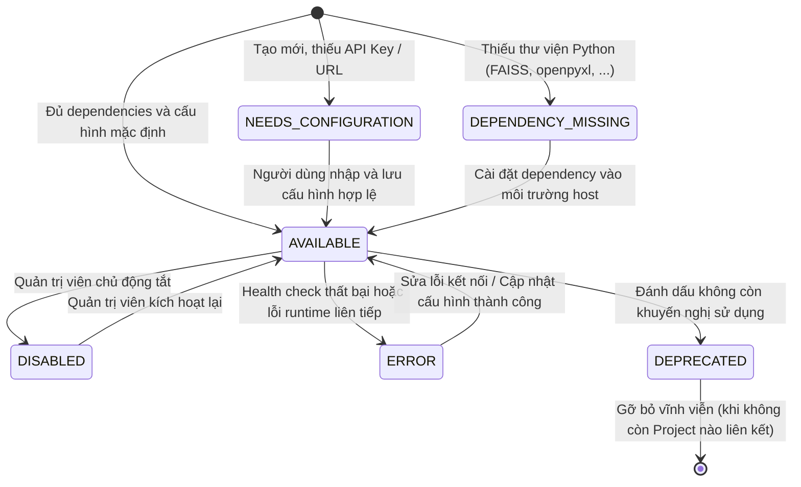

---

## 9. Biểu đồ Trạng thái: Vòng đời Lượt Thực thi (State Diagram: Tool Execution Lifecycle)

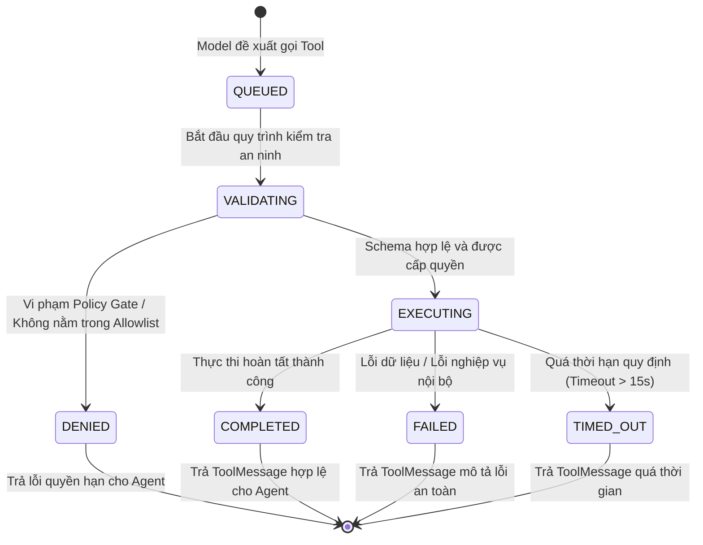

---

## 10. Biểu đồ Lớp Miền (Domain Class Diagram)

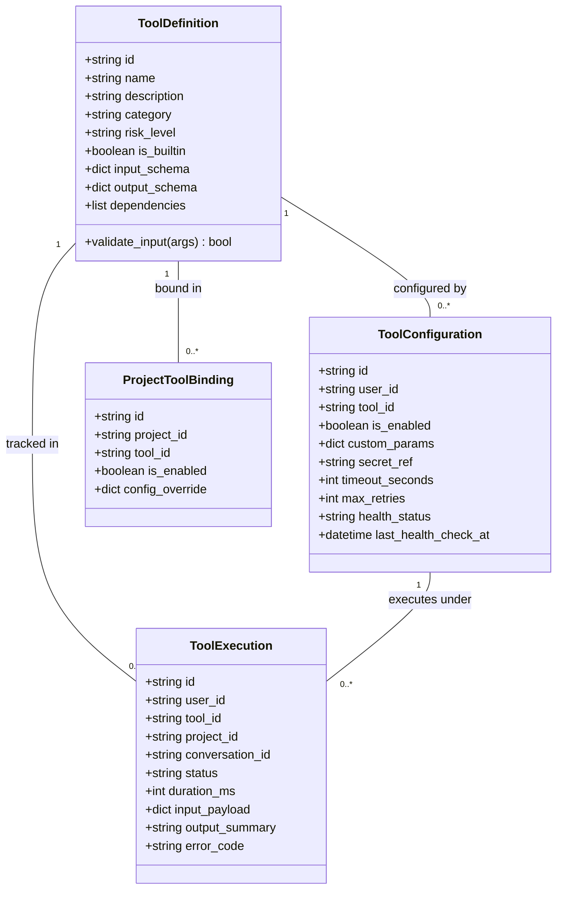

---

## 11. Biểu đồ Quan hệ Thực thể Đề xuất (Proposed ER Diagram)

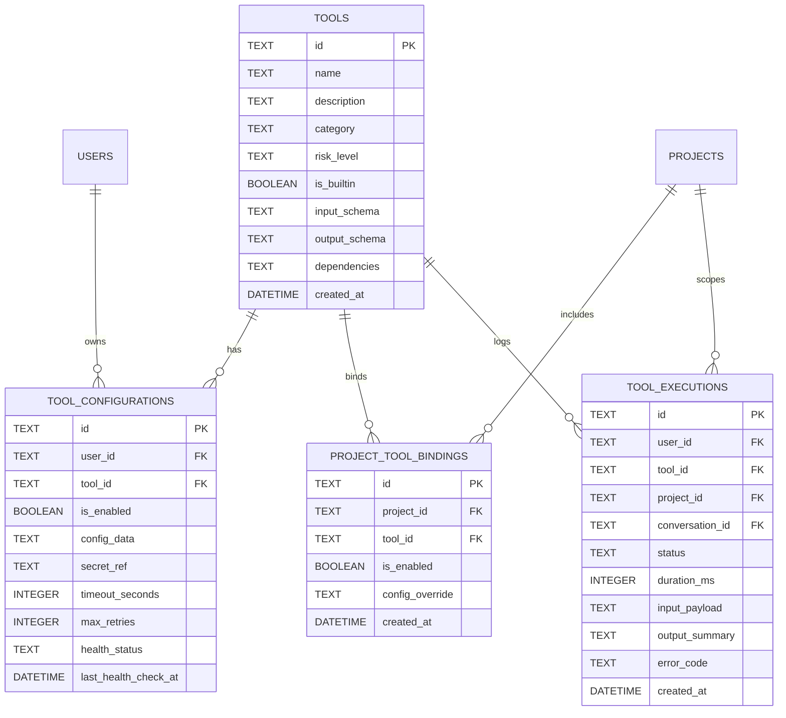

---

## 12. Biểu đồ Thành phần Kiến trúc (Component & Architecture Diagram)

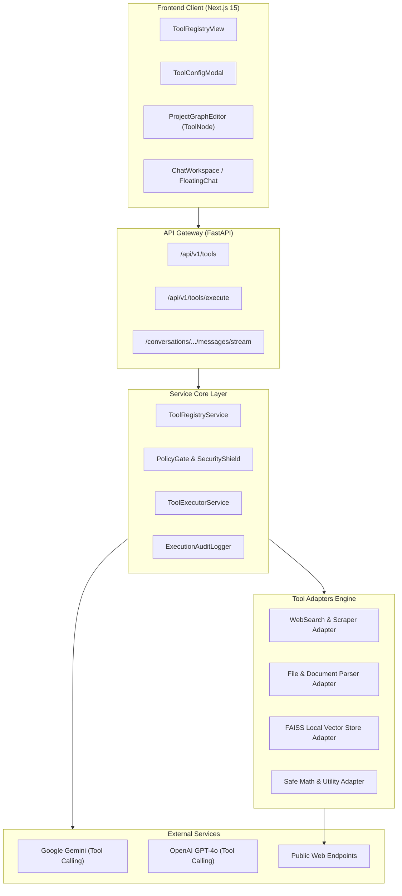

---

## 13. Biểu đồ Luồng Kiểm soát An ninh (Security Flow & Policy Gate)

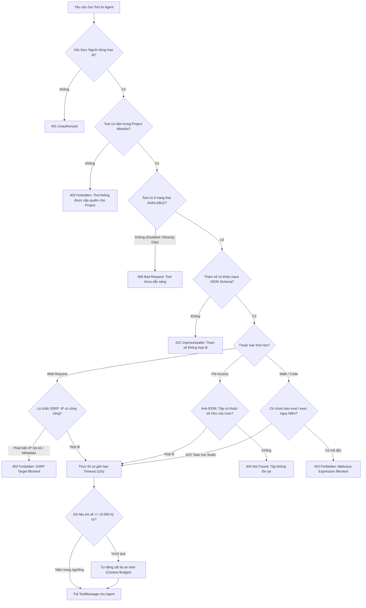

---

## 14. Biểu đồ Luồng Dữ liệu CSV (Data Flow: CSV Ingestion & Analysis)

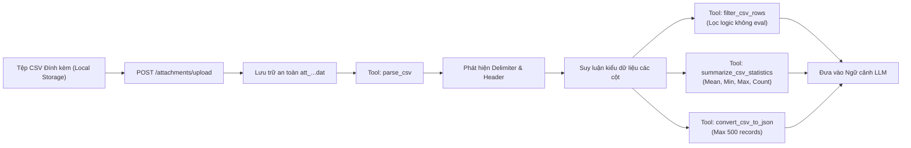

---

## 15. Biểu đồ Luồng Dữ liệu FAISS (Data Flow: Document Ingestion -> FAISS -> Retrieval)

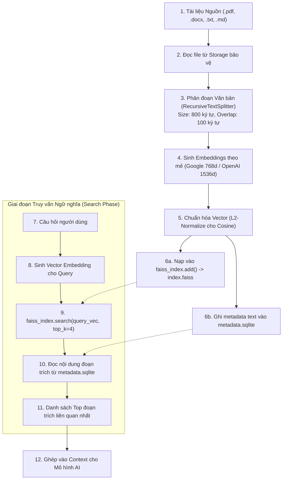

---

## 16. Biểu đồ Tương thích và Năng lực Mô hình (Compatibility Diagram)

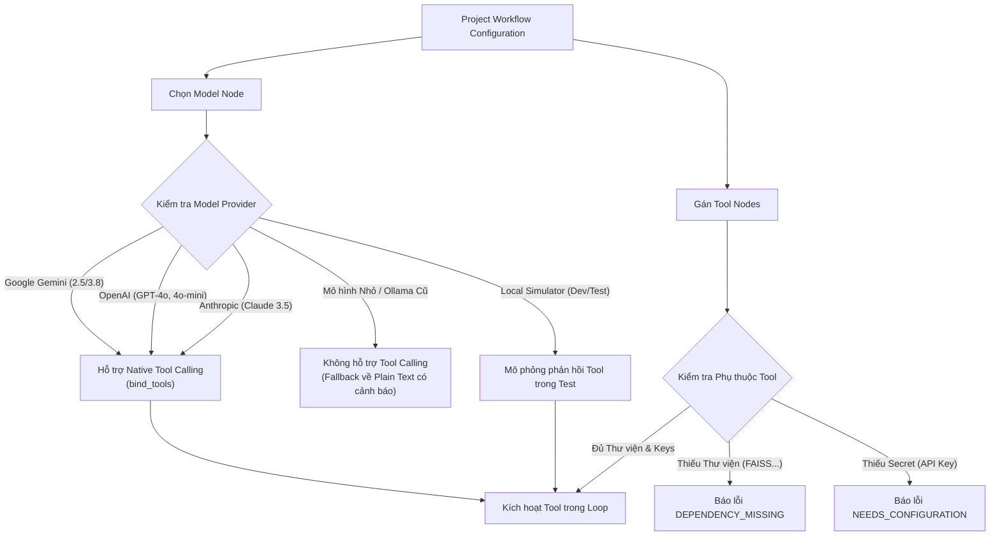
